# Deep Learning – Previous Year Questions (PYQ) with Full Solutions

> Every question is shown as the original exam image, followed by a worked answer with **formulas, calculations, diagrams and graphs**.
> All numerical answers were re-computed in Python (NumPy) and cross-checked.

**How to use:** View this file on GitHub (maths renders automatically) or open `index.html` in a browser (or via GitHub Pages) for a nicer reading experience with a sidebar, dark mode and image zoom.

## Contents

| Paper | Source images | Questions |
|---|---|---|
| [**Paper A**](#paper-a) | `PYQ/…130619 … 130959 … 131047` (4 images) | Q1 – Q5 (conv size, back-prop, dropout, GD variants, gradients, bias-variance, AlexNet, VGG16, vanishing gradient) |
| [**Paper B**](#paper-b) | `PYQ/…131329 … 131348 … 131429 … 131454` (4 images) | Q1 – Q5 (CO/BL tagged: perceptron gates, LeNet-5, back-prop MSE, 1×1 / n×n conv, AlexNet conv1) |
| [**Paper C**](#paper-c) | `PYQ/…131608 … 131656 … 131739 … 131757` (4 images) | Q1 – Q6 (MP neuron, optimisers, CNN params, RNN/LSTM/GRU, BCE, guided back-prop, regularisation) |
| [**Paper D**](#paper-d) | `assets/pyq/d1.png` + later screenshots | Q1 – Q16 (cross-entropy, MP OR neuron, Adam/NAG, sequential learning, bias-variance T/F, CNN block, LSTM, perceptron convergence, ReLU, LeNet, XOR3, gradient proof, back-prop, transfer learning, skip connections, encoder-decoder, positional encoding, GAN/DCGAN/CycleGAN, U-Net, Q-learning, autoencoders, scaled attention, GRU, RNN step, AlexNet vs GoogLeNet, feature-map sizes, supervised vs unsupervised, perceptron circuits, GD variants, confusion matrix, bias-variance derivation, metrics/ROC, optimizers, L1/L2, conv1 params) |
| [**Quick formula sheet**](#formula-sheet) | – | All key formulas on one page |

---

<a id="paper-a"></a>
# Paper A

## A-Q1

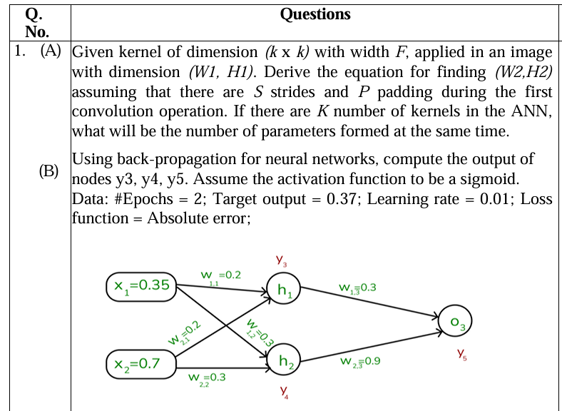

### A-Q1 (A) – Output size of a convolution and number of parameters

**Given:** input $W_1 \times H_1 \times D$, kernel $k\times k$ (width $F=k$), stride $S$, padding $P$, $K$ kernels.

**Derivation.** After zero-padding the width becomes $W_1+2P$. A window of width $F$ can start at positions $0, S, 2S, \dots$ and must fit inside the padded width, so the last start position $s_{max}\cdot S \le W_1+2P-F$. The number of positions is therefore

$$
\boxed{W_2=\left\lfloor\frac{W_1-F+2P}{S}\right\rfloor+1},\qquad
\boxed{H_2=\left\lfloor\frac{H_1-F+2P}{S}\right\rfloor+1},\qquad
D_2=K
$$

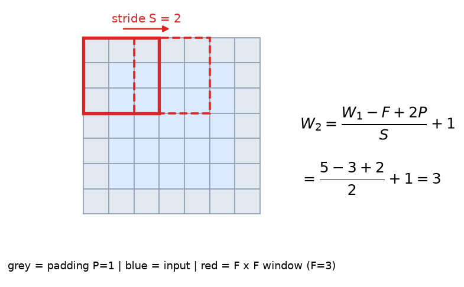

**Number of parameters.** One kernel has $F\cdot F\cdot D$ weights plus **1 bias**. With $K$ kernels:

$$
\boxed{\text{Params}=K\,(F\cdot F\cdot D+1)}
$$

(weights are shared across all positions, so the count does **not** depend on $W_1,H_1$.)

*Example:* $227\times227\times3$ input, $F=11$, $S=4$, $P=0$, $K=96$ → $W_2=(227-11)/4+1=55$; params $=96(11\cdot11\cdot3+1)=34{,}944$.

### A-Q1 (B) – Back-propagation numerical (sigmoid, absolute error, target 0.37)

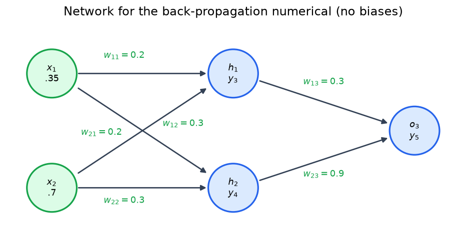

We solve this by **forward propagation + back-propagation for 2 epochs**, showing every calculation.

The network has 2 input nodes $x_1, x_2$, 2 hidden nodes $h_1, h_2$ (outputs $y_3, y_4$) and 1 output node $o_3$ (output $y_5$). Activation: **sigmoid**. Loss: **Absolute Error**.

#### 1 Given data

| Parameter | Value |
|---|---|
| $x_1$ | 0.35 |
| $x_2$ | 0.70 |
| Target output $t$ | 0.37 |
| Learning rate $\eta$ | 0.01 |
| Epochs | 2 |

Initial weights:

| Connection | Weight |
|---|---|
| $x_1 \to h_1$ ($w_{11}$) | 0.2 |
| $x_2 \to h_1$ ($w_{21}$) | 0.2 |
| $x_1 \to h_2$ ($w_{12}$) | 0.3 |
| $x_2 \to h_2$ ($w_{22}$) | 0.3 |
| $h_1 \to o_3$ ($w_{13}$) | 0.3 |
| $h_2 \to o_3$ ($w_{23}$) | 0.9 |

No bias terms are used because none are shown in the figure.

#### 2 Formulas used

$$\sigma(z)=\frac{1}{1+e^{-z}},\qquad \sigma'(z)=\sigma(z)\,\big(1-\sigma(z)\big)$$

$$E=\lvert t-y_5\rvert,\qquad \frac{\partial E}{\partial y_5}=\operatorname{sign}(y_5-t)=\begin{cases}+1 & y_5>t\\-1 & y_5<t\end{cases}$$

$$\delta_o=\frac{\partial E}{\partial y_5}\cdot y_5(1-y_5)=\operatorname{sign}(y_5-t)\,y_5(1-y_5)$$

$$\delta_{h_1}=y_3(1-y_3)\,\delta_o\,w_{13},\qquad \delta_{h_2}=y_4(1-y_4)\,\delta_o\,w_{23}$$

$$\frac{\partial E}{\partial w_{13}}=\delta_o\,y_3,\quad \frac{\partial E}{\partial w_{23}}=\delta_o\,y_4,\quad \frac{\partial E}{\partial w_{11}}=\delta_{h_1}x_1,\quad \frac{\partial E}{\partial w_{21}}=\delta_{h_1}x_2,\quad \frac{\partial E}{\partial w_{12}}=\delta_{h_2}x_1,\quad \frac{\partial E}{\partial w_{22}}=\delta_{h_2}x_2$$

$$w_{new}=w_{old}-\eta\,\frac{\partial E}{\partial w}$$

> The hidden deltas use the **old** output weights $w_{13}, w_{23}$ (the values used in the forward pass), not the freshly updated ones. All six weights are updated together at the end of the epoch.

#### 3 Epoch 1: forward propagation

**Step 1 – hidden node $h_1$ (output $y_3$)**

$$Net_{h_1}=x_1w_{11}+x_2w_{21}=0.35(0.200000)+0.7(0.200000)=0.070000+0.140000=0.210000$$

$$y_3=\frac{1}{1+e^{-0.210000}}\;\Rightarrow\;\boxed{y_3=0.552308}$$

**Step 2 – hidden node $h_2$ (output $y_4$)**

$$Net_{h_2}=x_1w_{12}+x_2w_{22}=0.35(0.300000)+0.7(0.300000)=0.105000+0.210000=0.315000$$

$$y_4=\frac{1}{1+e^{-0.315000}}\;\Rightarrow\;\boxed{y_4=0.578105}$$

**Step 3 – output node $o_3$ (output $y_5$)**

$$Net_{o_3}=y_3w_{13}+y_4w_{23}=0.552308(0.300000)+0.578105(0.900000)=0.165692+0.520295=0.685987$$

$$y_5=\frac{1}{1+e^{-0.685987}}\;\Rightarrow\;\boxed{y_5=0.665074}$$

**Step 4 – error**

$$E=\lvert t-y_5\rvert=\lvert 0.37-0.665074\rvert\;\Rightarrow\;\boxed{E=0.295074}$$

#### 4 Epoch 1: back-propagation and weight update

**Step 1 – output delta**

Since $y_5 > t$ (0.665074 > 0.37), $\operatorname{sign}(y_5-t)=+1$:

$$\delta_o=+1\cdot y_5(1-y_5)=+1\cdot 0.665074\,(1-0.665074)\;\Rightarrow\;\boxed{\delta_o=0.222751}$$

**Step 2 – update the output-layer weights**

$$\frac{\partial E}{\partial w_{13}}=\delta_oy_3=0.222751\times0.552308=0.123027$$

$$w_{13}^{new}=w_{13}-\eta\,\delta_oy_3=0.300000-0.01(0.123027)\;\Rightarrow\;\boxed{w_{13}=0.298770}$$

$$\frac{\partial E}{\partial w_{23}}=\delta_oy_4=0.222751\times0.578105=0.128773$$

$$w_{23}^{new}=w_{23}-\eta\,\delta_oy_4=0.900000-0.01(0.128773)\;\Rightarrow\;\boxed{w_{23}=0.898712}$$

**Step 3 – hidden deltas** (using the old $w_{13}, w_{23}$)

$$\delta_{h_1}=y_3(1-y_3)\,\delta_o\,w_{13}=0.552308(1-0.552308)(0.222751)(0.300000)\;\Rightarrow\;\boxed{\delta_{h_1}=0.016523}$$

$$\delta_{h_2}=y_4(1-y_4)\,\delta_o\,w_{23}=0.578105(1-0.578105)(0.222751)(0.900000)\;\Rightarrow\;\boxed{\delta_{h_2}=0.048896}$$

**Step 4 – update the input-to-hidden weights**

$$w_{11}^{new}=w_{11}-\eta\,\delta_{h_1}\,x_1=0.200000-0.01(0.016523)(0.35)\;\Rightarrow\;\boxed{w_{11}=0.199942}$$

$$w_{21}^{new}=w_{21}-\eta\,\delta_{h_1}\,x_2=0.200000-0.01(0.016523)(0.7)\;\Rightarrow\;\boxed{w_{21}=0.199884}$$

$$w_{12}^{new}=w_{12}-\eta\,\delta_{h_2}\,x_1=0.300000-0.01(0.048896)(0.35)\;\Rightarrow\;\boxed{w_{12}=0.299829}$$

$$w_{22}^{new}=w_{22}-\eta\,\delta_{h_2}\,x_2=0.300000-0.01(0.048896)(0.7)\;\Rightarrow\;\boxed{w_{22}=0.299658}$$

#### 5 Epoch 2: forward propagation

Use the weights updated at the end of epoch 1.

**Step 1 – hidden node $h_1$ (output $y_3$)**

$$Net_{h_1}=x_1w_{11}+x_2w_{21}=0.35(0.199942)+0.7(0.199884)=0.069980+0.139919=0.209899$$

$$y_3=\frac{1}{1+e^{-0.209899}}\;\Rightarrow\;\boxed{y_3=0.552283}$$

**Step 2 – hidden node $h_2$ (output $y_4$)**

$$Net_{h_2}=x_1w_{12}+x_2w_{22}=0.35(0.299829)+0.7(0.299658)=0.104940+0.209760=0.314701$$

$$y_4=\frac{1}{1+e^{-0.314701}}\;\Rightarrow\;\boxed{y_4=0.578032}$$

**Step 3 – output node $o_3$ (output $y_5$)**

$$Net_{o_3}=y_3w_{13}+y_4w_{23}=0.552283(0.298770)+0.578032(0.898712)=0.165005+0.519485=0.684490$$

$$y_5=\frac{1}{1+e^{-0.684490}}\;\Rightarrow\;\boxed{y_5=0.664740}$$

**Step 4 – error**

$$E=\lvert t-y_5\rvert=\lvert 0.37-0.664740\rvert\;\Rightarrow\;\boxed{E=0.294740}$$

#### 6 Epoch 2: back-propagation and weight update

**Step 1 – output delta**

Since $y_5 > t$ (0.664740 > 0.37), $\operatorname{sign}(y_5-t)=+1$:

$$\delta_o=+1\cdot y_5(1-y_5)=+1\cdot 0.664740\,(1-0.664740)\;\Rightarrow\;\boxed{\delta_o=0.222861}$$

**Step 2 – update the output-layer weights**

$$\frac{\partial E}{\partial w_{13}}=\delta_oy_3=0.222861\times0.552283=0.123082$$

$$w_{13}^{new}=w_{13}-\eta\,\delta_oy_3=0.298770-0.01(0.123082)\;\Rightarrow\;\boxed{w_{13}=0.297539}$$

$$\frac{\partial E}{\partial w_{23}}=\delta_oy_4=0.222861\times0.578032=0.128821$$

$$w_{23}^{new}=w_{23}-\eta\,\delta_oy_4=0.898712-0.01(0.128821)\;\Rightarrow\;\boxed{w_{23}=0.897424}$$

**Step 3 – hidden deltas** (using the old $w_{13}, w_{23}$)

$$\delta_{h_1}=y_3(1-y_3)\,\delta_o\,w_{13}=0.552283(1-0.552283)(0.222861)(0.298770)\;\Rightarrow\;\boxed{\delta_{h_1}=0.016464}$$

$$\delta_{h_2}=y_4(1-y_4)\,\delta_o\,w_{23}=0.578032(1-0.578032)(0.222861)(0.898712)\;\Rightarrow\;\boxed{\delta_{h_2}=0.048852}$$

**Step 4 – update the input-to-hidden weights**

$$w_{11}^{new}=w_{11}-\eta\,\delta_{h_1}\,x_1=0.199942-0.01(0.016464)(0.35)\;\Rightarrow\;\boxed{w_{11}=0.199885}$$

$$w_{21}^{new}=w_{21}-\eta\,\delta_{h_1}\,x_2=0.199884-0.01(0.016464)(0.7)\;\Rightarrow\;\boxed{w_{21}=0.199769}$$

$$w_{12}^{new}=w_{12}-\eta\,\delta_{h_2}\,x_1=0.299829-0.01(0.048852)(0.35)\;\Rightarrow\;\boxed{w_{12}=0.299658}$$

$$w_{22}^{new}=w_{22}-\eta\,\delta_{h_2}\,x_2=0.299658-0.01(0.048852)(0.7)\;\Rightarrow\;\boxed{w_{22}=0.299316}$$

#### 7 Weights after each epoch

| Weight | Initial | After epoch 1 | After epoch 2 |
|---|---|---|---|
| $w_{11}$ | 0.2 | 0.199942 | 0.199885 |
| $w_{21}$ | 0.2 | 0.199884 | 0.199769 |
| $w_{12}$ | 0.3 | 0.299829 | 0.299658 |
| $w_{22}$ | 0.3 | 0.299658 | 0.299316 |
| $w_{13}$ | 0.3 | 0.298770 | 0.297539 |
| $w_{23}$ | 0.9 | 0.898712 | 0.897424 |

#### 8 Final answer

| | Epoch 1 forward pass | Epoch 2 forward pass | Fresh forward pass with the final weights (after epoch 2 update) |
|---|---|---|---|
| $y_3$ (hidden $h_1$) | 0.552308 | 0.552283 | 0.552258 |
| $y_4$ (hidden $h_2$) | 0.578105 | 0.578032 | 0.577959 |
| $y_5$ (output $o_3$) | 0.665074 | 0.664740 | 0.664406 |
| Error $E$ | 0.295074 | 0.294740 | 0.294406 |

**Answer (outputs of the second epoch's forward pass):** $y_3\approx0.5523$, $y_4\approx0.5780$, $y_5\approx0.6647$, error after epoch 2 $E=0.294740$.

If the question means "after training for 2 epochs" (i.e. re-run the network with the final weights), then $y_3\approx0.5523$, $y_4\approx0.5780$, $y_5\approx0.6644$. State which interpretation you use.

The error falls from 0.295074 to 0.294740, so the network is learning, but with $\eta=0.01$ it moves toward the target $t=0.37$ very slowly.

#### 9 Exam checklist

1. Net input of each hidden node = weighted sum of the inputs; apply sigmoid to get $y_3, y_4$.
2. Net input of the output node from $y_3, y_4$; apply sigmoid to get $y_5$.
3. Compute the error.
4. Output delta $\delta_o$ (sign of $(y_5-t)$ times $y_5(1-y_5)$).
5. Hidden deltas from $\delta_o$ and the **old** output weights.
6. Update all six weights with $w_{new}=w_{old}-\eta\,\delta\cdot(\text{input of that weight})$.
7. Repeat the whole process for epoch 2 with the new weights.

---

## A-Q2

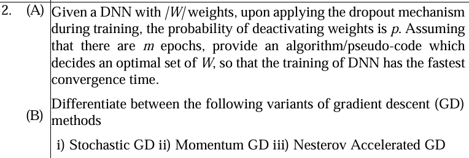

### A-Q2 (A) – Dropout algorithm for fastest convergence

Let $|W|$ be the number of weights, $p$ the probability a weight is **deactivated**, so each weight is **kept** with probability $q=1-p$, and $m$ epochs are available.

**Idea.** In every mini-batch a random sub-network of $\approx q|W|$ weights is trained (different each time → acts like an ensemble). The "optimal" $W$ is the one with the best *validation* loss; the dropout rate $p$ itself is tuned so the validation loss reaches its target in the fewest epochs. Weights are rescaled by $1/q$ ("inverted dropout") so no change is needed at test time.

```text
ALGORITHM  Dropout-Training(W, m, candidate set P = {0.1, 0.2, 0.3, 0.4, 0.5})
  best_p  <- None ; best_epochs <- infinity ; W_best <- None
  FOR each p in P:                                  # tune dropout probability
      q <- 1 - p
      initialise W (He / Xavier) ; eta <- initial learning rate
      FOR epoch = 1 .. m:
          FOR each mini-batch (X, Y):
              M  <- Bernoulli(q) mask, one bit per weight       # 1 = keep, 0 = drop
              W~ <- (M ⊙ W) / q                                  # inverted dropout
              Y^ <- forward(X ; W~)
              g  <- backprop( loss(Y^, Y) )  w.r.t. W~
              W  <- W - eta * (M ⊙ g)                            # only active weights learn
          val_loss <- evaluate(valid_set ; W)                    # NO mask at evaluation
          IF val_loss improved:  save W_p* <- W ; wait <- 0
          ELSE: wait <- wait + 1
          IF val_loss <= target  OR  wait >= patience:  BREAK   # early stop = fastest convergence
      IF epochs_used < best_epochs  AND  val_loss(W_p*) is lowest so far:
          best_p <- p ; best_epochs <- epochs_used ; W_best <- W_p*
  RETURN W_best, best_p
```

**Why it converges quickly / what is optimised**

* Expected number of updated weights per step $=(1-p)|W|$ → cheaper steps; a very large $p$ makes gradients too noisy and slows convergence, a very small $p$ gives no regularisation (over-fitting) – hence the search over $p$.
* Co-adaptation between weights is broken, so the generalisation gap shrinks and early stopping triggers sooner.
* Output of the retained network at test time: $\hat y=f(x;W)$ (full weights, since training used the $1/q$ scaling).

### A-Q2 (B) – Stochastic GD vs Momentum GD vs Nesterov Accelerated GD

| | **Stochastic GD (SGD)** | **Momentum GD** | **Nesterov Accelerated GD (NAG)** |
|---|---|---|---|
| Update | $w_{t+1}=w_t-\eta\,\nabla L_i(w_t)$ | $v_t=\gamma v_{t-1}+\eta\nabla L(w_t)$<br>$w_{t+1}=w_t-v_t$ | $v_t=\gamma v_{t-1}+\eta\nabla L(\,w_t-\gamma v_{t-1})$<br>$w_{t+1}=w_t-v_t$ |
| Gradient evaluated at | current point, one sample (or mini-batch) | current point (full history kept in $v_t$) | **look-ahead point** $w_t-\gamma v_{t-1}$ |
| Memory of past gradients | none | exponentially weighted sum of past gradients | same, but corrected |
| Behaviour | noisy, zig-zags across narrow valleys, slow | accelerates along consistent direction, damps zig-zag, but can **overshoot** the minimum | anticipates the next position, so it slows down *before* the minimum – less overshoot, faster convergence |
| Extra hyper-parameter | – | $\gamma\approx0.9$ | $\gamma\approx0.9$ |
| Typical convergence rate (convex) | $O(1/\sqrt t)$ | – | $O(1/t^{2})$ |

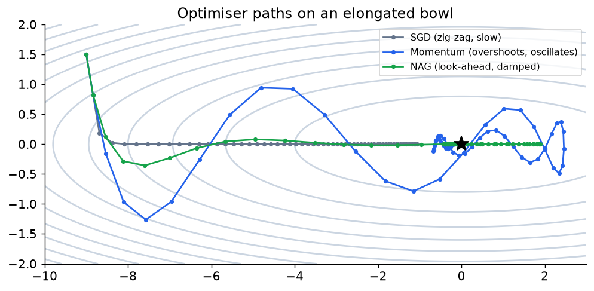

*Intuition:* Momentum = "ball rolling downhill" (first compute gradient, then take a big jump). NAG = "ball that looks ahead": first make the momentum jump, **then** compute the gradient there and correct.

---

## A-Q3

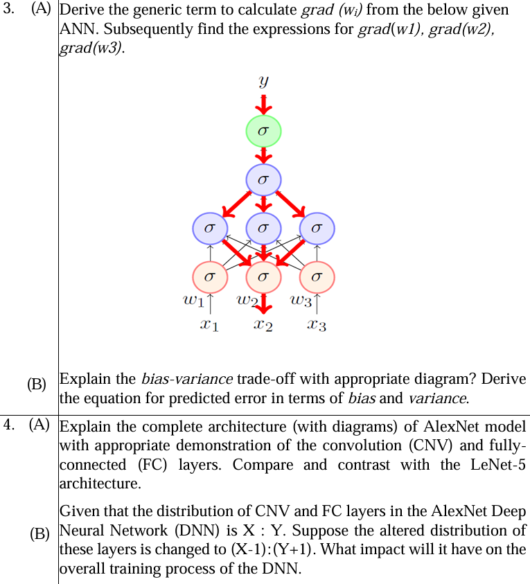

### A-Q3 (A) – Generic term of $\operatorname{grad}(w_i)$

Reading the figure: input $x_i$ is multiplied by $w_i$ and goes into a sigmoid unit of layer 1, which feeds (fully connected) 3 sigmoid units of layer 2, then one unit in layer 3, then the output unit that produces $y$.

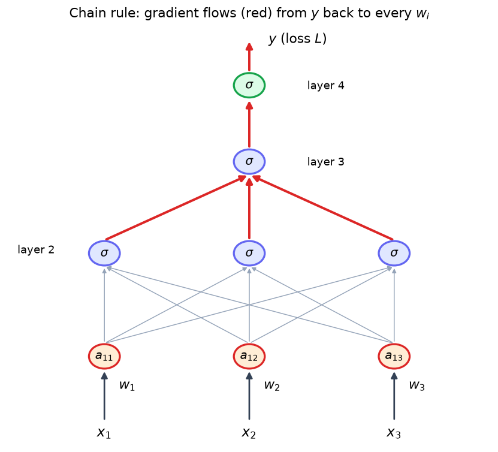

Define (σ = sigmoid):

$$
a_{1i}=\sigma(w_ix_i),\qquad
a_{2j}=\sigma\Big(\sum_i v_{ji}\,a_{1i}\Big),\qquad
a_3=\sigma\Big(\sum_j u_j\,a_{2j}\Big),\qquad
y=a_4=\sigma(c\,a_3),\qquad L=L(y,\text{target})
$$

By the **chain rule**, the gradient of $w_i$ is the product of all local derivatives along **every path** from $L$ to $w_i$ (red arrows – three paths, one through each middle unit $j$):

$$
\boxed{
\operatorname{grad}(w_i)=\frac{\partial L}{\partial w_i}
=\frac{\partial L}{\partial y}\;\cdot\;\underbrace{y(1-y)\,c}_{\partial y/\partial a_3}\;\cdot\;\underbrace{a_3(1-a_3)}_{}\;
\sum_{j=1}^{3}\Big[u_j\,a_{2j}(1-a_{2j})\,v_{ji}\Big]\;\cdot\;a_{1i}(1-a_{1i})\;\cdot\;x_i
}
$$

Writing $\delta_4=\dfrac{\partial L}{\partial y}y(1-y)$, $\delta_3=\delta_4\,c\,a_3(1-a_3)$, $\delta_{2j}=\delta_3\,u_j\,a_{2j}(1-a_{2j})$, $\delta_{1i}=a_{1i}(1-a_{1i})\sum_j\delta_{2j}v_{ji}$:

$$
\operatorname{grad}(w_i)=\delta_{1i}\,x_i
$$

**Specific expressions** (set $i=1,2,3$, the same shared factor $S=\dfrac{\partial L}{\partial y}y(1-y)\,c\,a_3(1-a_3)$):

$$
\operatorname{grad}(w_1)=S\sum_{j}u_j a_{2j}(1-a_{2j})v_{j1}\;a_{11}(1-a_{11})\,x_1
$$

$$
\operatorname{grad}(w_2)=S\sum_{j}u_j a_{2j}(1-a_{2j})v_{j2}\;a_{12}(1-a_{12})\,x_2
$$

$$
\operatorname{grad}(w_3)=S\sum_{j}u_j a_{2j}(1-a_{2j})v_{j3}\;a_{13}(1-a_{13})\,x_3
$$

Note every term contains the factor $\sigma'\le0.25$ once per layer → the product shrinks with depth (vanishing gradient, see A-Q5 (B)).

### A-Q3 (B) – Bias–variance trade-off and the error equation

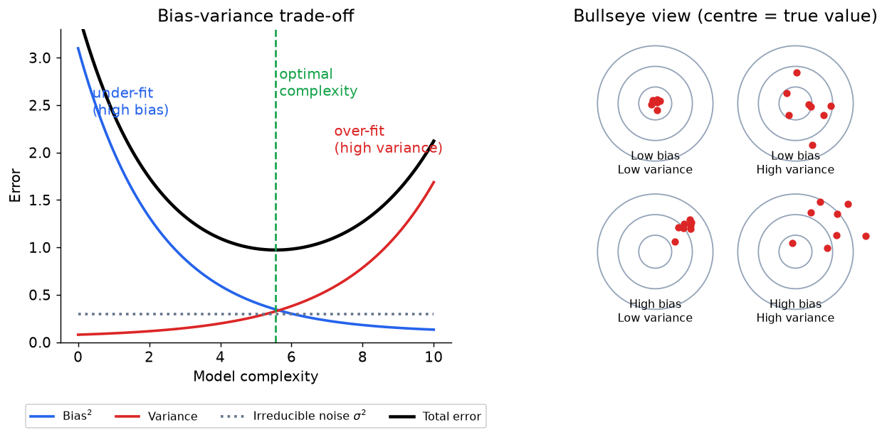

* **Bias** – error from wrong/too simple assumptions (under-fitting). High bias: model misses the real pattern; training and test error both high.
* **Variance** – sensitivity to the particular training set (over-fitting). High variance: tiny training error, big test error.
* Increasing model complexity **decreases bias but increases variance** → the test error is U-shaped; the sweet spot minimises their sum.

**Derivation.** Let $Y=f(x)+\varepsilon$ with $E[\varepsilon]=0$, $\operatorname{Var}(\varepsilon)=\sigma^2$, and let $\hat f(x)$ be the model learnt from a random training set. At a point $x$:

$$
\mathrm{Err}(x)=E\big[(Y-\hat f)^2\big]=E\big[(f+\varepsilon-\hat f)^2\big]
=E\big[(f-\hat f)^2\big]+2E[\varepsilon]\,E[f-\hat f]+E[\varepsilon^2]
$$

(noise is independent of $\hat f$, and $E[\varepsilon]=0$), so $\mathrm{Err}=E[(f-\hat f)^2]+\sigma^2$.
Add and subtract $E[\hat f]$:

$$
E\big[(f-\hat f)^2\big]=E\big[(f-E\hat f+E\hat f-\hat f)^2\big]
=(f-E\hat f)^2+E\big[(\hat f-E\hat f)^2\big]+2(f-E\hat f)\underbrace{E[E\hat f-\hat f]}_{=0}
$$

$$
\boxed{\mathrm{Err}(x)=\underbrace{\big(E[\hat f(x)]-f(x)\big)^2}_{\text{Bias}^2}+\underbrace{E\big[(\hat f(x)-E[\hat f(x)])^2\big]}_{\text{Variance}}+\underbrace{\sigma^2}_{\text{irreducible error}}}
$$

| | Low variance | High variance |
|---|---|---|
| **Low bias** | ideal | over-fit |
| **High bias** | under-fit | worst case |

---

## A-Q4

### A-Q4 (A) – AlexNet architecture, and comparison with LeNet-5

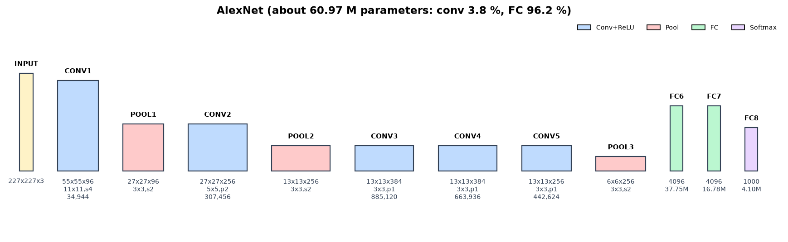

**AlexNet** (Krizhevsky et al., 2012). Input $227\times227\times3$ (the paper says 224, 227 makes the arithmetic exact), 5 CONV (CNV) layers + 3 FC layers, 1000-way softmax.

| Layer | Type | Filters / neurons | Kernel, stride, pad | Output | Parameters |
|---|---|---|---|---|---|
| Input | – | – | – | 227×227×3 | 0 |
| CONV1 | conv + ReLU (+LRN) | 96 | 11×11, S=4, P=0 | 55×55×96 | (11·11·3+1)·96 = **34,944** |
| POOL1 | max pool | – | 3×3, S=2 | 27×27×96 | 0 |
| CONV2 | conv + ReLU (+LRN) | 256 | 5×5, S=1, P=2 | 27×27×256 | (5·5·48+1)·256 = **307,456** (two GPU groups → depth 48) |
| POOL2 | max pool | – | 3×3, S=2 | 13×13×256 | 0 |
| CONV3 | conv + ReLU | 384 | 3×3, S=1, P=1 | 13×13×384 | (3·3·256+1)·384 = **885,120** |
| CONV4 | conv + ReLU | 384 | 3×3, S=1, P=1 | 13×13×384 | (3·3·192+1)·384 = **663,936** |
| CONV5 | conv + ReLU | 256 | 3×3, S=1, P=1 | 13×13×256 | (3·3·192+1)·256 = **442,624** |
| POOL3 | max pool | – | 3×3, S=2 | 6×6×256 | 0 |
| FC6 | fully connected + ReLU + dropout 0.5 | 4096 | flatten 9216 | 4096 | 9216·4096+4096 = **37,752,832** |
| FC7 | fully connected + ReLU + dropout 0.5 | 4096 | – | 4096 | 4096·4096+4096 = **16,781,312** |
| FC8 | fully connected + softmax | 1000 | – | 1000 | 4096·1000+1000 = **4,097,000** |
| **Total** | | | | | **≈ 60.97 M** (conv = 2.33 M, FC = 58.63 M) |

Size formula used for each CNV layer: $W_2=\frac{W_1-F+2P}{S}+1$; e.g. CONV1: $(227-11)/4+1=55$; POOL1: $(55-3)/2+1=27$; POOL3: $(13-3)/2+1=6$.

**LeNet-5** (LeCun, 1998)

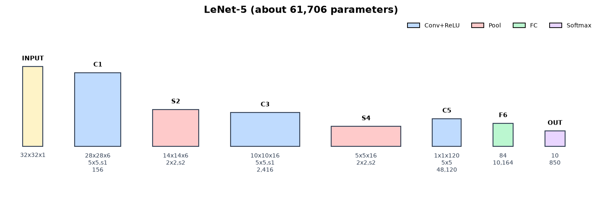

**Compare / contrast**

| Feature | LeNet-5 (1998) | AlexNet (2012) |
|---|---|---|
| Input | 32×32×1 (grey) | 227×227×3 (RGB) |
| Task | digit recognition (10 classes) | ImageNet (1000 classes) |
| Depth | 2 CONV + 2 pool + 3 FC = 5 weight layers (C1,C3,C5,F6,OUT) | 5 CONV + 3 pool + 3 FC = 8 weight layers |
| Parameters | ≈ 61 K | ≈ 61 M (1000× more) |
| Activation | tanh / sigmoid | **ReLU** (6× faster training, no saturation) |
| Pooling | average (subsampling), non-overlapping 2×2 | **max**, overlapping 3×3 / stride 2 |
| Regularisation | none | **dropout (0.5)**, data augmentation, LRN |
| Hardware | CPU | 2 GPUs (model split) |
| Common | alternating CONV → pool, then FC classifier, trained by back-prop | |

### A-Q4 (B) – Changing the CNV : FC ratio from $X:Y$ to $(X-1):(Y+1)$

In AlexNet $X:Y=5:3$. The new design is $4:4$ – one conv layer removed, one FC layer added (e.g. an extra 4096→4096 FC).

| Quantity | Effect |
|---|---|
| Parameters | FC layers hold ≈ 96 % of AlexNet's weights. Extra FC adds ≈ 4096·4096 ≈ **+16.8 M (+27 %)**; removing e.g. CONV3 saves only ≈ 0.9 M. Net: model becomes **much larger**. |
| Compute (FLOPs) | Conv layers hold ≈ 92 % of the multiply-adds (≈ 666 M of ≈ 724 M); removing CONV3 saves ≈ 150 M MACs (≈ 21 %), the FC adds only ≈ 17 M. Per-epoch compute **drops**, but memory and weight-update traffic rise. |
| Feature quality | One fewer conv layer = shallower hierarchy / smaller receptive field → weaker, less abstract spatial features → lower accuracy on images. |
| Over-fitting | More dense weights with no weight-sharing → much higher over-fitting risk; needs more dropout / more data. |
| Convergence | FC layers are fully dense (no weight sharing) and one more sigmoid/ReLU layer in the chain lengthens the gradient path; the classifier has to learn from poorer features, so more epochs are typically needed to reach the same accuracy. |

**Impact on overall training:** faster per-iteration compute but larger memory footprint, poorer generalisation, higher risk of over-fitting and typically slower/less stable convergence to the same accuracy – so the change is generally **detrimental**; moving the ratio in the opposite direction ($(X+1):(Y-1)$, as in VGG/ResNet which use few FC layers) is the beneficial trend.

---

## A-Q5

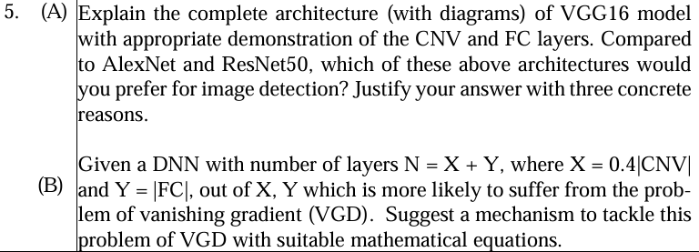

### A-Q5 (A) – VGG16 architecture and choice for image detection

VGG16 (Simonyan & Zisserman, 2014) uses only **3×3 conv (stride 1, pad 1)** and **2×2 max-pool (stride 2)**; **13 CNV + 3 FC = 16 weight layers**. Two stacked 3×3 convs see a 5×5 area but use $2\cdot9C^2=18C^2$ weights vs $25C^2$ for one 5×5 (and add more non-linearity).

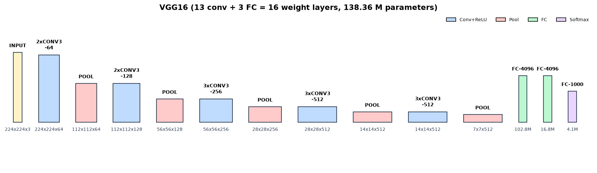

| Block | Layers | Output | Params |
|---|---|---|---|
| Input | – | 224×224×3 | 0 |
| Block 1 | CONV3-64 ×2, POOL | 224×224×64 → 112×112×64 | 1,792 + 36,928 |
| Block 2 | CONV3-128 ×2, POOL | 112×112×128 → 56×56×128 | 73,856 + 147,584 |
| Block 3 | CONV3-256 ×3, POOL | 56×56×256 → 28×28×256 | 295,168 + 590,080 + 590,080 |
| Block 4 | CONV3-512 ×3, POOL | 28×28×512 → 14×14×512 | 1,180,160 + 2,359,808 + 2,359,808 |
| Block 5 | CONV3-512 ×3, POOL | 14×14×512 → 7×7×512 | 2,359,808 ×3 |
| FC1 | 25088 → 4096 | 4096 | 102,764,544 |
| FC2 | 4096 → 4096 | 4096 | 16,781,312 |
| FC3 | 4096 → 1000 + softmax | 1000 | 4,097,000 |
| **Total** | | | **138,357,544** (conv 14.71 M, FC 123.64 M) |

**Which is preferable for image detection – AlexNet, VGG16 or ResNet50? → ResNet50.** Three concrete reasons:

1. **Better optimisation / depth through skip connections.** $y=F(x)+x$ gives a gradient path of $1+\partial F/\partial x$, so very deep (50 layers) networks train without vanishing gradients, whereas VGG16 and AlexNet have no shortcuts. Higher accuracy: ImageNet top-1 ≈ 76 % (ResNet50) vs ≈ 72 % (VGG16) vs ≈ 57 % (AlexNet).
2. **Far fewer parameters and compute.** ResNet50 ≈ 25.6 M params and ≈ 4 GMACs vs VGG16 ≈ 138 M and ≈ 15.5 GMACs; it ends with *global average pooling* instead of huge FC layers, so it is fully convolutional (works on any input size – needed in detection) and is cheaper to train / run.
3. **Multi-scale, localisation-friendly features.** ResNet's stages (C2–C5 at strides 4–32) feed detector heads such as Faster R-CNN/FPN/Mask R-CNN, and FC layers (used in VGG/AlexNet) throw away spatial layout that detection needs. ResNet backbones are the de-facto standard for detectors.

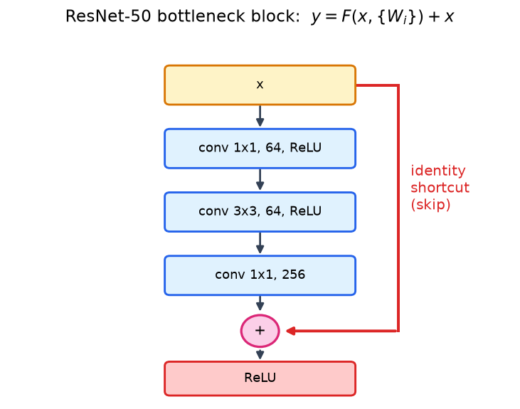

### A-Q5 (B) – Which of $X=0.4\lvert CNV\rvert$, $Y=\lvert FC\rvert$ suffers more from vanishing gradient? Remedy

In a CNN the **CNV block comes first (near the input)** and the **FC block last (near the loss)**. Back-propagated gradients reach the FC layers first and only reach the CNV layers after passing through all FC layers, so the quantity far from the output – **X (the convolutional layers)** – is more likely to suffer from VGD. (The deeper the net, i.e. the larger $N=X+Y$, the worse it gets, and the earliest layers receive the smallest updates.)

**Why (mathematics).** For layer $l$ with pre-activation $z^{l}=W^{l}a^{l-1}$ and $a^l=\sigma(z^l)$:

$$
\frac{\partial L}{\partial W^{1}}=\frac{\partial L}{\partial a^{N}}\prod_{l=2}^{N}\Big(\operatorname{diag}\big(\sigma'(z^{l})\big)\,W^{l}\Big)\;\cdot\operatorname{diag}\big(\sigma'(z^{1})\big)\,a^{0\,T}
$$

For sigmoid $\sigma'(z)=\sigma(1-\sigma)\le\tfrac14$, so with $\lVert W\rVert\lesssim1$ the product behaves like $(0.25)^{N}$ → 0.

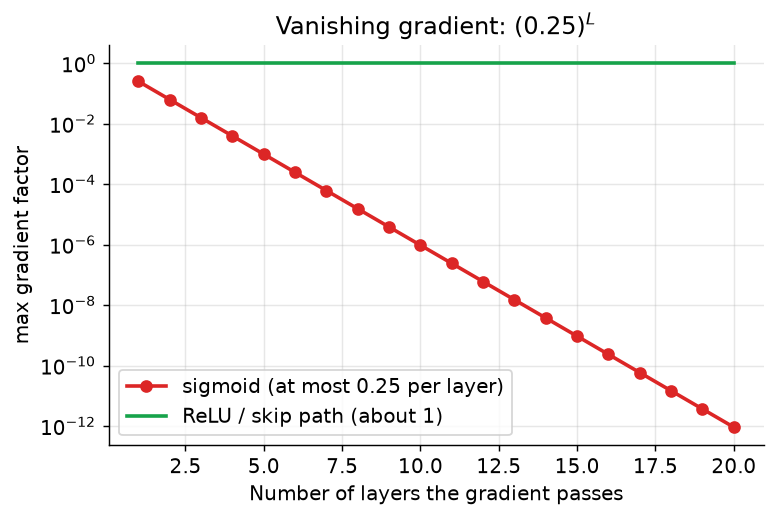

**Mechanisms to tackle it**

1. **ReLU-family activations** $f(z)=\max(0,z)$, $f'(z)=1$ for $z>0$ → no shrinking factor:
 $\prod f'\!=1$ along active paths.
2. **Residual (skip) connections** $a^{l+1}=a^{l}+F(a^{l})$:

$$
\frac{\partial a^{L}}{\partial a^{l}}=\prod_{k=l}^{L-1}\Big(I+\frac{\partial F_k}{\partial a^{k}}\Big)=I+\dots
\quad\Rightarrow\quad
\frac{\partial L}{\partial a^{l}}=\frac{\partial L}{\partial a^{L}}\Big(1+\frac{\partial}{\partial a^{l}}\sum_{k=l}^{L-1}F_k\Big)
$$

 the "1" guarantees a gradient highway.
3. **Batch normalisation** – keeps $z$ inside the sensitive region: $\hat z=\dfrac{z-\mu_B}{\sqrt{\sigma_B^2+\epsilon}}$, $y=\gamma\hat z+\beta$.
4. **Proper initialisation** – He: $\operatorname{Var}(w)=2/n_{in}$ (Xavier: $2/(n_{in}+n_{out})$) keeps the variance of activations and gradients ≈ constant across layers.
5. Others: gradient clipping (for the opposite problem, exploding), auxiliary classifiers (GoogLeNet), shorter paths/dense connections.

---

<a id="paper-b"></a>
# Paper B

## B-Q1

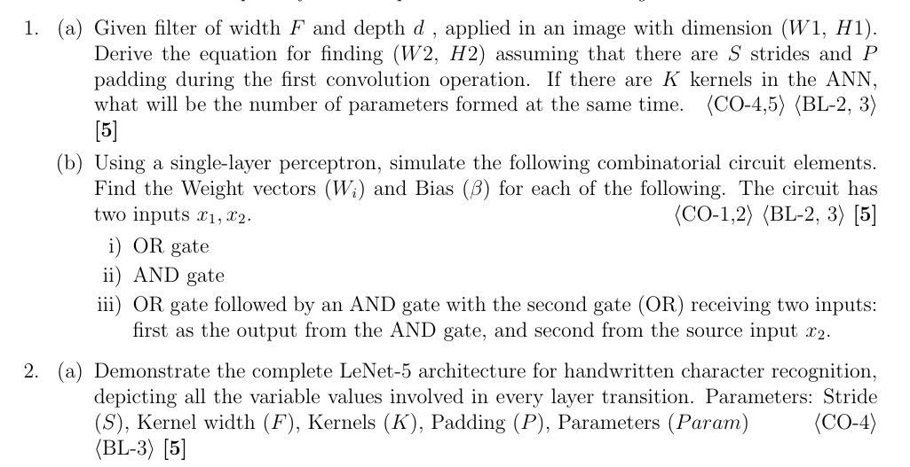

### B-Q1 (a) – Output size and parameters (filter width $F$, depth $d$)

Same as A-Q1 (A):

$$
W_2=\frac{W_1-F+2P}{S}+1,\quad H_2=\frac{H_1-F+2P}{S}+1,\quad D_2=K,\qquad
\text{Params}=K\,(F\cdot F\cdot d+1)
$$

(weights: $F\cdot F\cdot d$ per filter, +1 bias per filter, shared over all positions.)

### B-Q1 (b) – Single-layer perceptron for logic gates

Perceptron: $y=\begin{cases}1 & w_1x_1+w_2x_2+\beta\ge0\\0&\text{otherwise}\end{cases}$

| Gate | Weights $W=(w_1,w_2)$ | Bias $\beta$ | Check |
|---|---|---|---|
| **i) OR** | (1, 1) | −0.5 | (0,0)→−0.5→0; (0,1)→0.5→1; (1,0)→1; (1,1)→1.5→1 ✓ |
| **ii) AND** | (1, 1) | −1.5 | (0,0)→0; (0,1)→−0.5→0; (1,0)→0; (1,1)→0.5→1 ✓ |

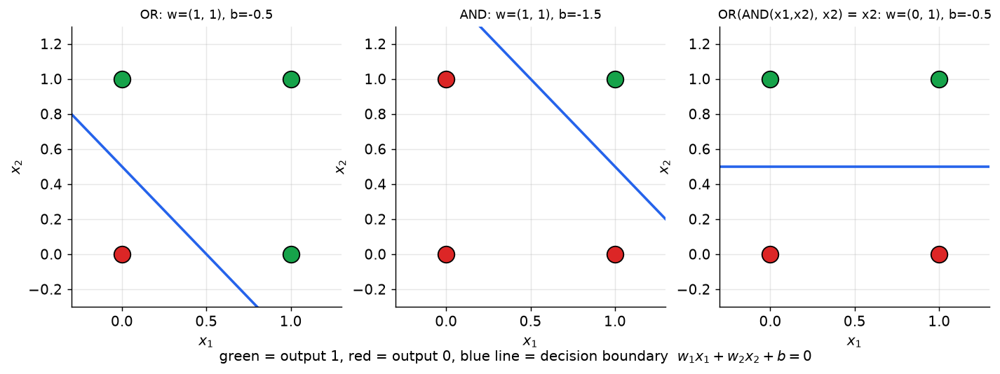

**iii) Composite circuit.** The text defines an AND gate on $(x_1,x_2)$ followed by an OR gate whose two inputs are the AND output $a$ and the source input $x_2$: $y=\mathrm{OR}(\mathrm{AND}(x_1,x_2),x_2)$.

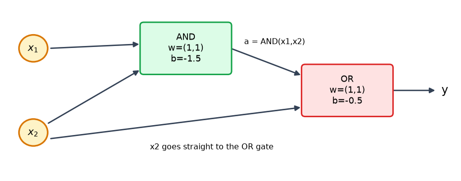

* AND unit: $W=(1,1)$, $\beta=-1.5$ → $a=x_1\wedge x_2$.
* OR unit (inputs $a,x_2$): $W=(1,1)$, $\beta=-0.5$ → $y=a\vee x_2$.

| $x_1$ | $x_2$ | $a=x_1\wedge x_2$ | $y=a\vee x_2$ |
|---|---|---|---|
| 0 | 0 | 0 | 0 |
| 0 | 1 | 0 | 1 |
| 1 | 0 | 0 | 0 |
| 1 | 1 | 1 | 1 |

The truth table shows $y=x_2$ (absorption law: $x_1x_2+x_2=x_2$). The other reading ("OR first, then AND with $x_2$") is $(x_1\vee x_2)\wedge x_2=x_2$ as well. So the whole circuit is also realised by **one** perceptron with $W=(0,\,1)$, $\beta=-0.5$.

---

## B-Q2

### B-Q2 (a) – LeNet-5 with every layer transition


Formula per layer: $W_2=\frac{W_1-F+2P}{S}+1$, conv params $=K(F^2D+1)$.

| Layer | Input | $F$ | $S$ | $P$ | $K$ | Output | Param |
|---|---|---|---|---|---|---|---|
| INPUT | 32×32×1 | – | – | – | – | 32×32×1 | 0 |
| C1 (conv) | 32×32×1 | 5 | 1 | 0 | 6 | $(32-5)/1+1=$ **28×28×6** | $(5\cdot5\cdot1+1)\cdot6=156$ |
| S2 (avg pool) | 28×28×6 | 2 | 2 | 0 | 6 | $(28-2)/2+1=$ **14×14×6** | 0 (12 in the original: 1 coeff + 1 bias per map) |
| C3 (conv) | 14×14×6 | 5 | 1 | 0 | 16 | $(14-5)+1=$ **10×10×16** | $(5\cdot5\cdot6+1)\cdot16=2{,}416$ (1,516 with the original sparse connection table) |
| S4 (avg pool) | 10×10×16 | 2 | 2 | 0 | 16 | **5×5×16** | 0 |
| C5 (conv = FC) | 5×5×16 | 5 | 1 | 0 | 120 | $(5-5)+1=$ **1×1×120** | $(5\cdot5\cdot16+1)\cdot120=48{,}120$ |
| F6 (FC) | 120 | – | – | – | 84 | **84** | $(120+1)\cdot84=10{,}164$ |
| OUTPUT (FC) | 84 | – | – | – | 10 | **10** | $(84+1)\cdot10=850$ |
| **Total** | | | | | | | **61,706** |

Activation: tanh/sigmoid (classic), output RBF/softmax. Flow: $32\times32\to28\times28\to14\times14\to10\times10\to5\times5\to1\times1\to84\to10$.

---

## B-Q2 (b)

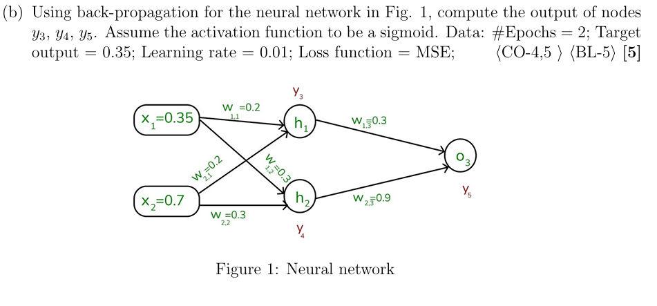

### B-Q2 (b) – Back-propagation (sigmoid, MSE, target 0.35)

Same network and initial weights as A-Q1 (B) (Figure 1). Only the target ($t=0.35$) and the loss ($E=\tfrac12(t-y_5)^2$) change. If your course defines MSE without the $\tfrac12$, every gradient and delta below is simply **doubled**.

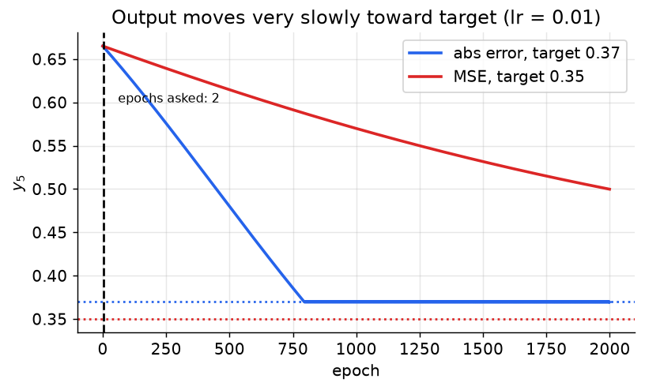

We solve this by **forward propagation + back-propagation for 2 epochs**, showing every calculation.

The network has 2 input nodes $x_1, x_2$, 2 hidden nodes $h_1, h_2$ (outputs $y_3, y_4$) and 1 output node $o_3$ (output $y_5$). Activation: **sigmoid**. Loss: **Mean Squared Error (MSE)**.

#### 1 Given data

| Parameter | Value |
|---|---|
| $x_1$ | 0.35 |
| $x_2$ | 0.70 |
| Target output $t$ | 0.35 |
| Learning rate $\eta$ | 0.01 |
| Epochs | 2 |

Initial weights:

| Connection | Weight |
|---|---|
| $x_1 \to h_1$ ($w_{11}$) | 0.2 |
| $x_2 \to h_1$ ($w_{21}$) | 0.2 |
| $x_1 \to h_2$ ($w_{12}$) | 0.3 |
| $x_2 \to h_2$ ($w_{22}$) | 0.3 |
| $h_1 \to o_3$ ($w_{13}$) | 0.3 |
| $h_2 \to o_3$ ($w_{23}$) | 0.9 |

No bias terms are used because none are shown in the figure.

#### 2 Formulas used

$$\sigma(z)=\frac{1}{1+e^{-z}},\qquad \sigma'(z)=\sigma(z)\,\big(1-\sigma(z)\big)$$

$$E=\tfrac12\,(t-y_5)^2,\qquad \frac{\partial E}{\partial y_5}=y_5-t$$

$$\delta_o=(y_5-t)\;y_5(1-y_5)$$

$$\delta_{h_1}=y_3(1-y_3)\,\delta_o\,w_{13},\qquad \delta_{h_2}=y_4(1-y_4)\,\delta_o\,w_{23}$$

$$\frac{\partial E}{\partial w_{13}}=\delta_o\,y_3,\quad \frac{\partial E}{\partial w_{23}}=\delta_o\,y_4,\quad \frac{\partial E}{\partial w_{11}}=\delta_{h_1}x_1,\quad \frac{\partial E}{\partial w_{21}}=\delta_{h_1}x_2,\quad \frac{\partial E}{\partial w_{12}}=\delta_{h_2}x_1,\quad \frac{\partial E}{\partial w_{22}}=\delta_{h_2}x_2$$

$$w_{new}=w_{old}-\eta\,\frac{\partial E}{\partial w}$$

> The hidden deltas use the **old** output weights $w_{13}, w_{23}$ (the values used in the forward pass), not the freshly updated ones. All six weights are updated together at the end of the epoch.

#### 3 Epoch 1: forward propagation

**Step 1 – hidden node $h_1$ (output $y_3$)**

$$Net_{h_1}=x_1w_{11}+x_2w_{21}=0.35(0.200000)+0.7(0.200000)=0.070000+0.140000=0.210000$$

$$y_3=\frac{1}{1+e^{-0.210000}}\;\Rightarrow\;\boxed{y_3=0.552308}$$

**Step 2 – hidden node $h_2$ (output $y_4$)**

$$Net_{h_2}=x_1w_{12}+x_2w_{22}=0.35(0.300000)+0.7(0.300000)=0.105000+0.210000=0.315000$$

$$y_4=\frac{1}{1+e^{-0.315000}}\;\Rightarrow\;\boxed{y_4=0.578105}$$

**Step 3 – output node $o_3$ (output $y_5$)**

$$Net_{o_3}=y_3w_{13}+y_4w_{23}=0.552308(0.300000)+0.578105(0.900000)=0.165692+0.520295=0.685987$$

$$y_5=\frac{1}{1+e^{-0.685987}}\;\Rightarrow\;\boxed{y_5=0.665074}$$

**Step 4 – error**

$$E=\tfrac12(t-y_5)^2=\tfrac12(0.35-0.665074)^2=\tfrac12(-0.315074)^2\;\Rightarrow\;\boxed{E=0.049636}$$

#### 4 Epoch 1: back-propagation and weight update

**Step 1 – output delta**

$$\delta_o=(y_5-t)\,y_5(1-y_5)=(0.665074-0.35)(0.665074)(1-0.665074)=0.315074\times0.222751\;\Rightarrow\;\boxed{\delta_o=0.070183}$$

**Step 2 – update the output-layer weights**

$$\frac{\partial E}{\partial w_{13}}=\delta_oy_3=0.070183\times0.552308=0.038763$$

$$w_{13}^{new}=w_{13}-\eta\,\delta_oy_3=0.300000-0.01(0.038763)\;\Rightarrow\;\boxed{w_{13}=0.299612}$$

$$\frac{\partial E}{\partial w_{23}}=\delta_oy_4=0.070183\times0.578105=0.040573$$

$$w_{23}^{new}=w_{23}-\eta\,\delta_oy_4=0.900000-0.01(0.040573)\;\Rightarrow\;\boxed{w_{23}=0.899594}$$

**Step 3 – hidden deltas** (using the old $w_{13}, w_{23}$)

$$\delta_{h_1}=y_3(1-y_3)\,\delta_o\,w_{13}=0.552308(1-0.552308)(0.070183)(0.300000)\;\Rightarrow\;\boxed{\delta_{h_1}=0.005206}$$

$$\delta_{h_2}=y_4(1-y_4)\,\delta_o\,w_{23}=0.578105(1-0.578105)(0.070183)(0.900000)\;\Rightarrow\;\boxed{\delta_{h_2}=0.015406}$$

**Step 4 – update the input-to-hidden weights**

$$w_{11}^{new}=w_{11}-\eta\,\delta_{h_1}\,x_1=0.200000-0.01(0.005206)(0.35)\;\Rightarrow\;\boxed{w_{11}=0.199982}$$

$$w_{21}^{new}=w_{21}-\eta\,\delta_{h_1}\,x_2=0.200000-0.01(0.005206)(0.7)\;\Rightarrow\;\boxed{w_{21}=0.199964}$$

$$w_{12}^{new}=w_{12}-\eta\,\delta_{h_2}\,x_1=0.300000-0.01(0.015406)(0.35)\;\Rightarrow\;\boxed{w_{12}=0.299946}$$

$$w_{22}^{new}=w_{22}-\eta\,\delta_{h_2}\,x_2=0.300000-0.01(0.015406)(0.7)\;\Rightarrow\;\boxed{w_{22}=0.299892}$$

#### 5 Epoch 2: forward propagation

Use the weights updated at the end of epoch 1.

**Step 1 – hidden node $h_1$ (output $y_3$)**

$$Net_{h_1}=x_1w_{11}+x_2w_{21}=0.35(0.199982)+0.7(0.199964)=0.069994+0.139974=0.209968$$

$$y_3=\frac{1}{1+e^{-0.209968}}\;\Rightarrow\;\boxed{y_3=0.552300}$$

**Step 2 – hidden node $h_2$ (output $y_4$)**

$$Net_{h_2}=x_1w_{12}+x_2w_{22}=0.35(0.299946)+0.7(0.299892)=0.104981+0.209925=0.314906$$

$$y_4=\frac{1}{1+e^{-0.314906}}\;\Rightarrow\;\boxed{y_4=0.578082}$$

**Step 3 – output node $o_3$ (output $y_5$)**

$$Net_{o_3}=y_3w_{13}+y_4w_{23}=0.552300(0.299612)+0.578082(0.899594)=0.165476+0.520039=0.685515$$

$$y_5=\frac{1}{1+e^{-0.685515}}\;\Rightarrow\;\boxed{y_5=0.664969}$$

**Step 4 – error**

$$E=\tfrac12(t-y_5)^2=\tfrac12(0.35-0.664969)^2=\tfrac12(-0.314969)^2\;\Rightarrow\;\boxed{E=0.049603}$$

#### 6 Epoch 2: back-propagation and weight update

**Step 1 – output delta**

$$\delta_o=(y_5-t)\,y_5(1-y_5)=(0.664969-0.35)(0.664969)(1-0.664969)=0.314969\times0.222785\;\Rightarrow\;\boxed{\delta_o=0.070170}$$

**Step 2 – update the output-layer weights**

$$\frac{\partial E}{\partial w_{13}}=\delta_oy_3=0.070170\times0.552300=0.038755$$

$$w_{13}^{new}=w_{13}-\eta\,\delta_oy_3=0.299612-0.01(0.038755)\;\Rightarrow\;\boxed{w_{13}=0.299225}$$

$$\frac{\partial E}{\partial w_{23}}=\delta_oy_4=0.070170\times0.578082=0.040564$$

$$w_{23}^{new}=w_{23}-\eta\,\delta_oy_4=0.899594-0.01(0.040564)\;\Rightarrow\;\boxed{w_{23}=0.899189}$$

**Step 3 – hidden deltas** (using the old $w_{13}, w_{23}$)

$$\delta_{h_1}=y_3(1-y_3)\,\delta_o\,w_{13}=0.552300(1-0.552300)(0.070170)(0.299612)\;\Rightarrow\;\boxed{\delta_{h_1}=0.005198}$$

$$\delta_{h_2}=y_4(1-y_4)\,\delta_o\,w_{23}=0.578082(1-0.578082)(0.070170)(0.899594)\;\Rightarrow\;\boxed{\delta_{h_2}=0.015396}$$

**Step 4 – update the input-to-hidden weights**

$$w_{11}^{new}=w_{11}-\eta\,\delta_{h_1}\,x_1=0.199982-0.01(0.005198)(0.35)\;\Rightarrow\;\boxed{w_{11}=0.199964}$$

$$w_{21}^{new}=w_{21}-\eta\,\delta_{h_1}\,x_2=0.199964-0.01(0.005198)(0.7)\;\Rightarrow\;\boxed{w_{21}=0.199927}$$

$$w_{12}^{new}=w_{12}-\eta\,\delta_{h_2}\,x_1=0.299946-0.01(0.015396)(0.35)\;\Rightarrow\;\boxed{w_{12}=0.299892}$$

$$w_{22}^{new}=w_{22}-\eta\,\delta_{h_2}\,x_2=0.299892-0.01(0.015396)(0.7)\;\Rightarrow\;\boxed{w_{22}=0.299784}$$

#### 7 Weights after each epoch

| Weight | Initial | After epoch 1 | After epoch 2 |
|---|---|---|---|
| $w_{11}$ | 0.2 | 0.199982 | 0.199964 |
| $w_{21}$ | 0.2 | 0.199964 | 0.199927 |
| $w_{12}$ | 0.3 | 0.299946 | 0.299892 |
| $w_{22}$ | 0.3 | 0.299892 | 0.299784 |
| $w_{13}$ | 0.3 | 0.299612 | 0.299225 |
| $w_{23}$ | 0.9 | 0.899594 | 0.899189 |

#### 8 Final answer

| | Epoch 1 forward pass | Epoch 2 forward pass | Fresh forward pass with the final weights (after epoch 2 update) |
|---|---|---|---|
| $y_3$ (hidden $h_1$) | 0.552308 | 0.552300 | 0.552292 |
| $y_4$ (hidden $h_2$) | 0.578105 | 0.578082 | 0.578059 |
| $y_5$ (output $o_3$) | 0.665074 | 0.664969 | 0.664863 |
| Error $E$ | 0.049636 | 0.049603 | 0.049570 |

**Answer (outputs of the second epoch's forward pass):** $y_3\approx0.5523$, $y_4\approx0.5781$, $y_5\approx0.6650$, error after epoch 2 $E=0.049603$.

If the question means "after training for 2 epochs" (i.e. re-run the network with the final weights), then $y_3\approx0.5523$, $y_4\approx0.5781$, $y_5\approx0.6649$. State which interpretation you use.

The error falls from 0.049636 to 0.049603, so the network is learning, but with $\eta=0.01$ it moves toward the target $t=0.35$ very slowly.

#### 9 Exam checklist

1. Net input of each hidden node = weighted sum of the inputs; apply sigmoid to get $y_3, y_4$.
2. Net input of the output node from $y_3, y_4$; apply sigmoid to get $y_5$.
3. Compute the error.
4. Output delta $\delta_o$ ($(y_5-t)$ times $y_5(1-y_5)$).
5. Hidden deltas from $\delta_o$ and the **old** output weights.
6. Update all six weights with $w_{new}=w_{old}-\eta\,\delta\cdot(\text{input of that weight})$.
7. Repeat the whole process for epoch 2 with the new weights.

---

## B-Q3

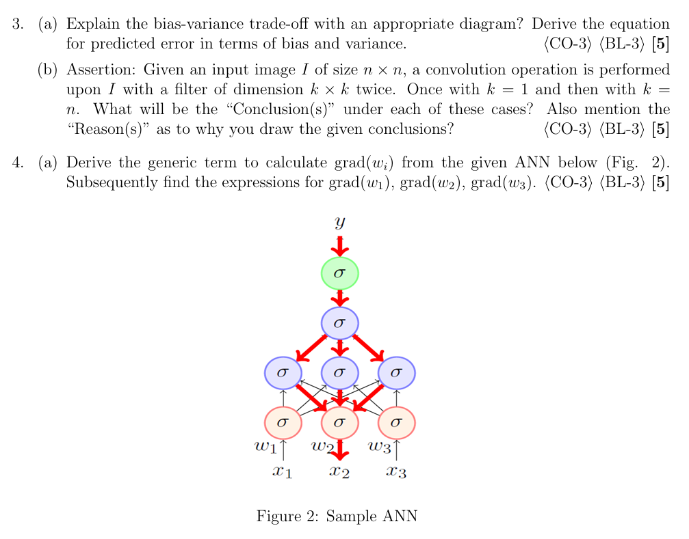

### B-Q3 (a) – Bias–variance trade-off and error equation

Identical to **A-Q3 (B)** above:

$$
\mathrm{Err}(x)=\mathrm{Bias}^2+\mathrm{Variance}+\sigma^2
$$


### B-Q3 (b) – Conv filter $k=1$ vs $k=n$ on an $n\times n$ image

Output size $=\dfrac{n-k+2P}{S}+1$ with $P=0,\;S=1$.

| | **Case 1: $k=1$** | **Case 2: $k=n$** |
|---|---|---|
| Output size | $\frac{n-1}{1}+1=n$ → **$n\times n$** | $\frac{n-n}{1}+1=1$ → **$1\times1$** |
| Parameters | 1 weight + 1 bias per filter (×depth) | $n^2$ weights + 1 bias |
| Operation | each output pixel $=w\cdot I(i,j)+b$ | one output $=\sum_{i,j}w_{ij}I_{ij}+b$ (a dot product over the whole image) |
| Receptive field | single pixel | whole image |

**Conclusions and reasons**

* **$k=1$:** the output is just a scaled/shifted copy of the input (identical spatial resolution). **Conclusion:** no spatial/neighbourhood feature (edges, textures) can be extracted – it only does a point-wise transform. With multi-channel input it mixes channels (1×1 convolution, used for dimensionality reduction/bottlenecks in Inception/ResNet and for adding non-linearity cheaply). *Reason:* the window never looks at neighbours.
* **$k=n$:** the output collapses to **a single scalar** (global feature). **Conclusion:** it behaves exactly like a **fully-connected neuron** – global information is captured, but all spatial structure is lost, there is no weight sharing or translation equivariance and the parameter count is huge ($n^2$ per filter). *Reason:* the one window covers the entire image, so only one position is possible.
* Practical filters (3×3, 5×5) sit between these extremes: local receptive field + weight sharing + few parameters.

---

## B-Q4

### B-Q4 (a) – Generic $\operatorname{grad}(w_i)$

Identical to **A-Q3 (A)**.


$$
\operatorname{grad}(w_i)=\frac{\partial L}{\partial y}\,y(1-y)\,c\;a_3(1-a_3)\sum_{j=1}^{3}u_j\,a_{2j}(1-a_{2j})\,v_{ji}\;a_{1i}(1-a_{1i})\;x_i,\qquad i=1,2,3
$$

---

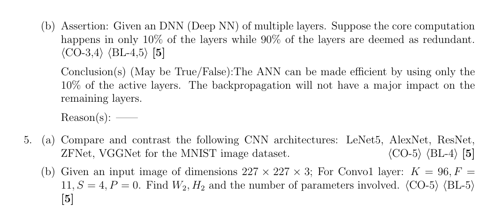

### B-Q4 (b) – Assertion: 10 % layers do the work, 90 % are redundant

**Conclusion(s):** *"The ANN can be made efficient by using only the 10 % active layers"* – **partly True (after pruning/retraining)**; *"back-propagation will not have a major impact on the remaining layers"* – **False**. Overall the assertion as written is **False**.

**Reasons**

1. A network is a *composition* $f=f_N\circ\dots\circ f_1$; layers are sequentially dependent. Simply deleting 90 % of layers breaks the chain (dimension mismatch, lost hierarchy of features) and accuracy collapses unless the model is **re-designed/retrained** – by pruning, distillation to a smaller student, early-exit networks, or lottery-ticket sub-networks. This is why efficiency can indeed be obtained *with* these techniques (e.g. in ResNets, removing single blocks changes accuracy only slightly because of skip connections).
2. Back-propagation passes through **every** layer: $\dfrac{\partial L}{\partial W^{l}}=\delta^{l}(a^{l-1})^{T}$ with $\delta^{l}=(W^{l+1})^{T}\delta^{l+1}\odot\sigma'(z^l)$. A layer deemed "redundant" still multiplies the gradient by $W\,\sigma'$ – it can **attenuate** (vanishing) or **amplify** (exploding) the gradient reaching the "core" layers, and it still costs memory, compute and weight updates. So back-prop certainly has an impact on the remaining layers.
3. Redundant layers can also add over-fitting and training time; therefore redundancy is removed deliberately (pruning, quantisation, compression) rather than ignored.

---

## B-Q5

### B-Q5 (a) – LeNet-5, AlexNet, ResNet, ZFNet, VGGNet on MNIST

MNIST: 70 000 grey-scale $28\times28\times1$ images, 10 classes (60 k train / 10 k test).

| Model | Year | Depth | Params | Key idea | Suitability for MNIST |
|---|---|---|---|---|---|
| **LeNet-5** | 1998 | 7 (5 weight) | ≈ 61 K | CONV–pool–FC, avg pooling, tanh | Designed for it; input padded to 32×32; ≈ 99 % accuracy, very fast, tiny memory – **best fit** |
| **AlexNet** | 2012 | 8 | ≈ 61 M | ReLU, dropout, overlapping max-pool, GPU | Image must be resized to 227×227×3 and replicated to RGB; massively over-parameterised for 28×28 digits → slow, over-fits, no real gain (~99.3 %) |
| **ZFNet** | 2013 | 8 | ≈ 60 M | AlexNet with smaller first filter (7×7, S=2) + deconvnet visualisation | Same issues as AlexNet; useful to *visualise* what filters learn |
| **VGGNet (16/19)** | 2014 | 16/19 | 138 M / 144 M | Only 3×3 convs, deep & uniform | Heavy: 5 poolings need ≥32×32 inputs; huge FC layers; overkill, can reach ≈ 99.5 % with resizing |
| **ResNet** (18/34/50) | 2015 | 18–152 | 11 M–60 M (R50: 25.6 M) | Skip connections $y=F(x)+x$, BN | Works well (small ResNets ≈ 99.6 %), trains deep nets stably, but more compute than needed for MNIST |

**Conclusion:** for MNIST the simple, small **LeNet-5** gives essentially the same accuracy at a tiny fraction of the cost; deeper nets (ResNet) can give marginal gains with tuning, while AlexNet/ZFNet/VGG are over-sized.


### B-Q5 (b) – Conv1 of AlexNet

Input $227\times227\times3$, $K=96$, $F=11$, $S=4$, $P=0$:

$$
W_2=H_2=\frac{227-11+0}{4}+1=\frac{216}{4}+1=\boxed{55}
$$

Output volume $55\times55\times96$.

$$
\text{Params}=K(F\cdot F\cdot D+1)=96\,(11\cdot11\cdot3+1)=96\cdot364=\boxed{34{,}944}
$$

(34,848 weights + 96 biases.)

---

<a id="paper-c"></a>
# Paper C

## C-Q1

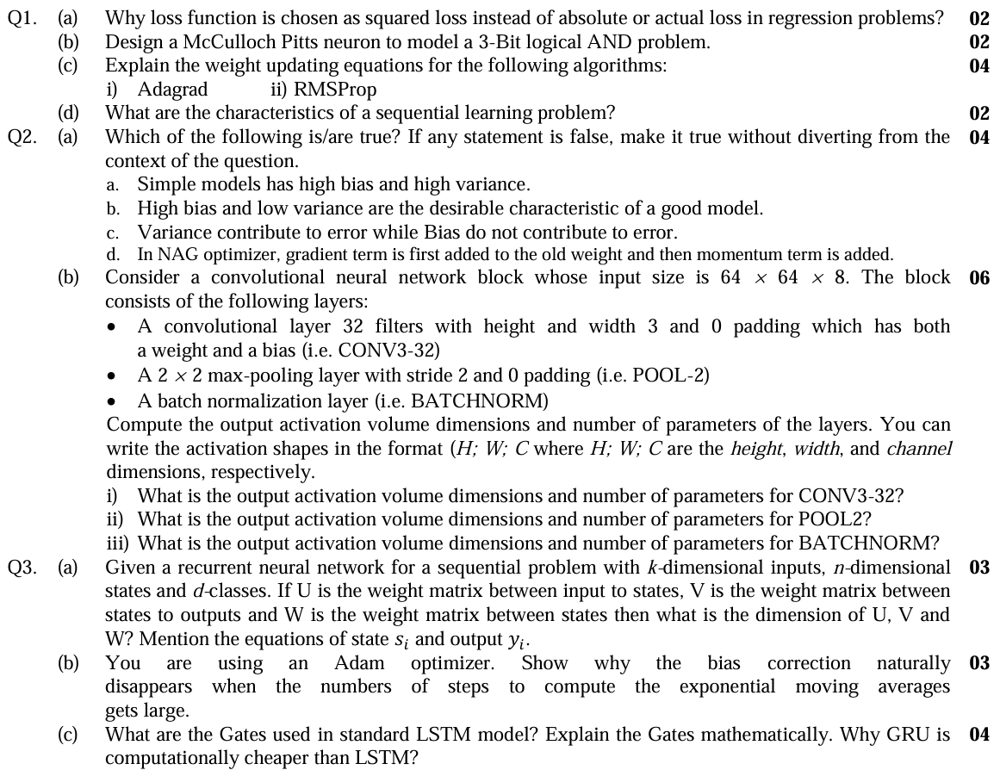

### C-Q1 (a) – Why squared loss instead of absolute (or 0-1 "actual") loss in regression? [2]

| Property | Squared loss $(y-\hat y)^2$ | Absolute loss $\lvert y-\hat y\rvert$ | 0-1 / "actual" loss |
|---|---|---|---|
| Differentiable everywhere | **Yes** | No (kink at 0) | No (step) |
| Gradient | $-2(y-\hat y)$ – proportional to the error: big steps when far, automatically small steps near the minimum | constant $\pm1$ – does not shrink, oscillates around the optimum | zero almost everywhere – no learning signal |
| Convex, smooth, unique minimum for linear models | Yes | Convex but not smooth | No |
| Statistical meaning | Maximum-likelihood under Gaussian noise | MLE under Laplace noise | – |
| Closed form | Normal equations $w=(X^TX)^{-1}X^Ty$ | none | none |

So squared loss gives smooth, well-behaved gradients (and penalises large errors more). Its drawback is sensitivity to outliers.

### C-Q1 (b) – McCulloch–Pitts neuron for 3-bit AND [2]

MP neuron: inputs are binary, all excitatory weights $=+1$, output $y=1$ iff $\sum x_i\ge\theta$.

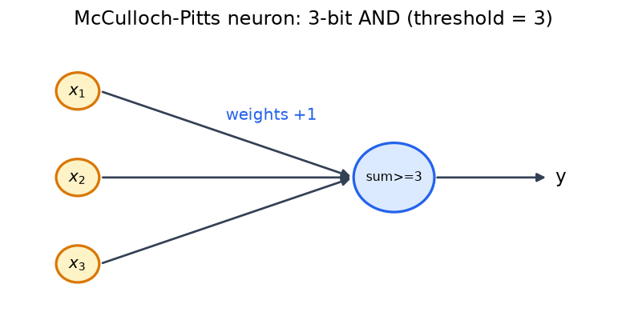

$$
y=\begin{cases}1&x_1+x_2+x_3\ge3\\0&\text{otherwise}\end{cases}\qquad(\theta=3)
$$

| $x_1x_2x_3$ | 000 | 001 | 010 | 011 | 100 | 101 | 110 | 111 |
|---|---|---|---|---|---|---|---|---|
| $\sum$ | 0 | 1 | 1 | 2 | 1 | 2 | 2 | 3 |
| $y$ | 0 | 0 | 0 | 0 | 0 | 0 | 0 | **1** |

### C-Q1 (c) – Weight-update equations [4]

Let $g_t=\nabla_wL(w_t)$, learning rate $\eta$, small $\epsilon$ (≈1e-8).

**i) Adagrad** (per-parameter learning rate that shrinks with the accumulated squared gradient)

$$
G_t=G_{t-1}+g_t^{2}\quad(\text{element-wise}),\qquad
w_{t+1}=w_t-\frac{\eta}{\sqrt{G_t+\epsilon}}\;g_t
$$

* frequently-updated weights get small steps; rare features get large steps (good for sparse data);
* drawback: $G_t$ only grows, so the learning rate decays to zero and learning stops early.

**ii) RMSProp** (exponential moving average instead of the full sum)

$$
E[g^2]_t=\rho\,E[g^2]_{t-1}+(1-\rho)\,g_t^{2}\quad(\rho\approx0.9),\qquad
w_{t+1}=w_t-\frac{\eta}{\sqrt{E[g^2]_t+\epsilon}}\;g_t
$$

* forgets old gradients, so the learning rate does not vanish; fixes Adagrad's decay problem.

### C-Q1 (d) – Characteristics of a sequential learning problem [2]

1. **Order matters** – the data are ordered (time, text, speech, DNA); shuffling within a sequence destroys the information.
2. **Temporal / long-range dependence** – the output at step $t$ depends on current *and past* inputs (memory/state is required).
3. **Variable-length** inputs and/or outputs (padding / masking needed).
4. **Parameter sharing across time** – the same function (weights $U,V,W$) is applied at every step.
5. **Samples are not i.i.d.** (neighbouring elements are correlated); training uses back-propagation through time.
6. Input/output may be sequences in different modes: one-to-many, many-to-one, many-to-many.

---

## C-Q2

### C-Q2 (a) – True/False with corrections [4]

| # | Statement | Verdict | Corrected (true) statement |
|---|---|---|---|
| a | Simple models have high bias and high variance. | **False** | Simple models have **high bias and low variance** (they under-fit). |
| b | High bias and low variance are the desirable characteristics of a good model. | **False** | A good model has **low bias and low variance**. |
| c | Variance contributes to error while bias does not. | **False** | **Both** contribute: $\mathrm{Err}=\mathrm{Bias}^2+\mathrm{Variance}+\sigma^2$. |
| d | In NAG, the gradient term is first added to the old weight and then the momentum term is added. | **False** | In NAG the **momentum step is applied first** (look-ahead $w-\gamma v_{t-1}$), the gradient is then computed at that look-ahead point and the correction is added: $v_t=\gamma v_{t-1}+\eta\nabla L(w_t-\gamma v_{t-1}),\;w_{t+1}=w_t-v_t$. |

So none of the four statements is true as written.

### C-Q2 (b) – CNN block on a $64\times64\times8$ input [6]

Notation $(H,W,C)$.

**i) CONV3-32** (32 filters, 3×3, padding 0, stride 1)

$$
H_2=W_2=\frac{64-3+0}{1}+1=62,\qquad C_2=32\;\Rightarrow\;\boxed{(62,62,32)}
$$

$$
\text{Params}=(3\cdot3\cdot8+1)\cdot32=73\cdot32=\boxed{2{,}336}\quad(2{,}304\ \text{weights}+32\ \text{biases})
$$

**ii) POOL-2** (2×2 max, stride 2, padding 0) on $(62,62,32)$

$$
H=W=\frac{62-2}{2}+1=31\;\Rightarrow\;\boxed{(31,31,32)},\qquad\text{Params}=\boxed{0}
$$

**iii) BATCHNORM** on $(31,31,32)$ – output shape unchanged $\boxed{(31,31,32)}$. It learns one scale $\gamma$ and one shift $\beta$ **per channel**:

$$
\text{Trainable params}=2C=2\cdot32=\boxed{64}
$$

(frameworks such as Keras also keep the non-trainable running mean and variance, $2C=64$ more, so "128 total, 64 trainable".)

| Layer | Output | Parameters |
|---|---|---|
| Input | (64, 64, 8) | 0 |
| CONV3-32 | (62, 62, 32) | 2,336 |
| POOL-2 | (31, 31, 32) | 0 |
| BATCHNORM | (31, 31, 32) | 64 trainable (+64 running stats) |

---

## C-Q3

### C-Q3 (a) – RNN dimensions and equations [3]

$k$-dim input $x_i\in\mathbb R^{k}$, $n$-dim state $s_i\in\mathbb R^{n}$, $d$ classes, $y_i\in\mathbb R^{d}$.

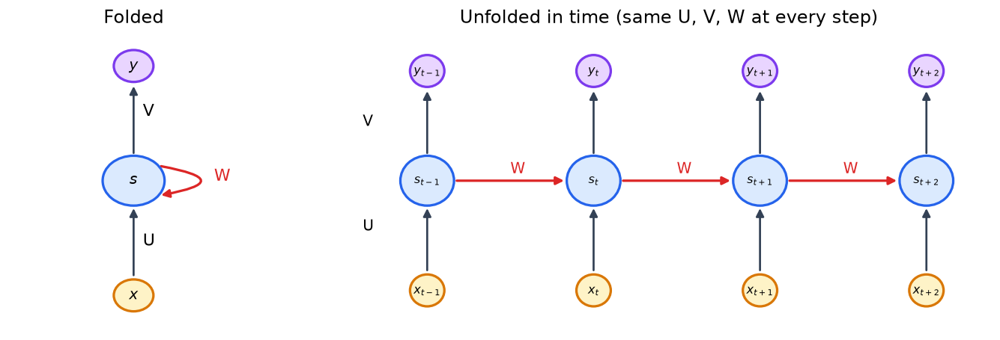

| Matrix | Role | Dimension |
|---|---|---|
| $U$ | input → state | $n\times k$ |
| $W$ | state → state (recurrent) | $n\times n$ |
| $V$ | state → output | $d\times n$ |

$$
\boxed{s_i=\sigma\big(U x_i+W s_{i-1}+b\big)},\qquad
\boxed{y_i=\operatorname{softmax}\big(V s_i+c\big)}
$$

($\sigma$ may be tanh; $b\in\mathbb R^n$, $c\in\mathbb R^d$ biases.) Total parameters $nk+n^2+dn+n+d$, independent of the sequence length.

### C-Q3 (b) – Adam: why the bias correction disappears for large $t$ [3]

Adam keeps exponential moving averages

$$
m_t=\beta_1m_{t-1}+(1-\beta_1)g_t,\qquad v_t=\beta_2v_{t-1}+(1-\beta_2)g_t^2,\qquad m_0=v_0=0
$$

Unrolling:

$$
m_t=(1-\beta_1)\sum_{i=1}^{t}\beta_1^{\,t-i}g_i
$$

Assume gradients have (roughly) a stationary mean $E[g_i]=E[g]$:

$$
E[m_t]=E[g]\,(1-\beta_1)\sum_{i=1}^{t}\beta_1^{\,t-i}=E[g]\,(1-\beta_1^{\,t})
$$

so $m_t$ is a **biased** (towards 0) estimator; the correction divides by the factor:

$$
\hat m_t=\frac{m_t}{1-\beta_1^{\,t}},\qquad \hat v_t=\frac{v_t}{1-\beta_2^{\,t}},\qquad
w_{t+1}=w_t-\eta\frac{\hat m_t}{\sqrt{\hat v_t}+\epsilon}
$$

Because $0<\beta<1$, $\beta^{t}\to0$ as $t\to\infty$, hence

$$
\lim_{t\to\infty}\frac{1}{1-\beta^{t}}=1\;\Rightarrow\;\hat m_t\to m_t,\;\hat v_t\to v_t
$$

– the correction factor tends to 1 and "disappears" on its own. Examples: $\beta_1=0.9$: $0.9^{50}=0.005$ (after about 50 steps); $\beta_2=0.999$: $0.999^{3000}=0.05$ (needs a few thousand steps).

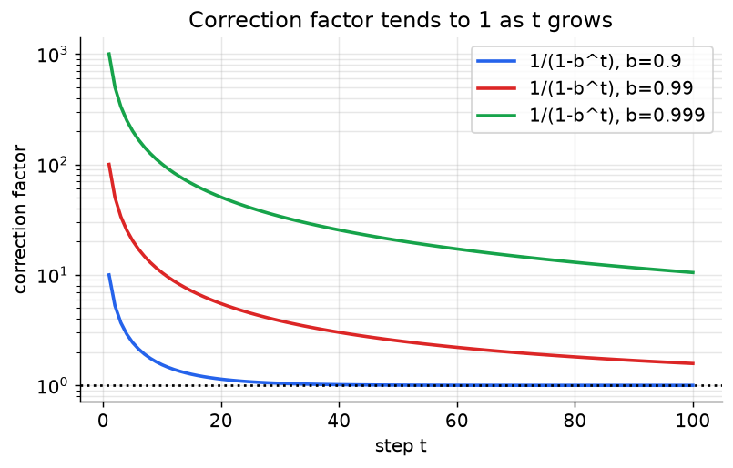

### C-Q3 (c) – Gates of an LSTM; why GRU is cheaper [4]

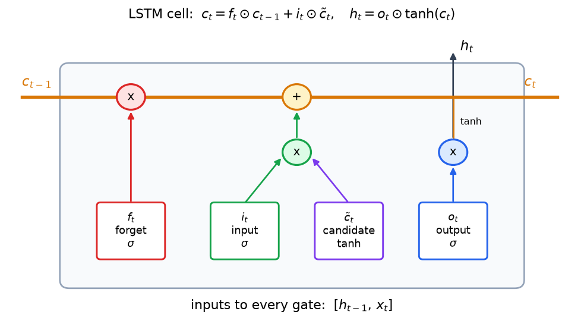

Let $z_t=[h_{t-1},x_t]$ (concatenation), $\sigma$=sigmoid, $\odot$=element-wise product.

| Gate | Equation | Function |
|---|---|---|
| **Forget gate** | $f_t=\sigma(W_fz_t+b_f)$ | how much of old cell state $c_{t-1}$ to keep |
| **Input gate** | $i_t=\sigma(W_iz_t+b_i)$ | how much of the new candidate to write |
| **Candidate (cell) state** | $\tilde c_t=\tanh(W_cz_t+b_c)$ | new information proposal |
| **Output gate** | $o_t=\sigma(W_oz_t+b_o)$ | how much of the cell to expose |

$$
c_t=f_t\odot c_{t-1}+i_t\odot\tilde c_t,\qquad h_t=o_t\odot\tanh(c_t)
$$

The additive cell-state update is why LSTM mitigates vanishing gradients: $\partial c_t/\partial c_{t-1}=f_t$.

**GRU** has 2 gates and no separate cell state:

$$
z_t=\sigma(W_zz_t'),\quad r_t=\sigma(W_rz_t'),\quad
\tilde h_t=\tanh\big(W[r_t\odot h_{t-1},x_t]\big),\quad
h_t=(1-z_t)\odot h_{t-1}+z_t\odot\tilde h_t
$$

**Why cheaper:** GRU has 3 weight blocks (update, reset, candidate) versus LSTM's 4 (forget, input, candidate, output) → parameters $3\,[n(n+k)+n]$ vs $4\,[n(n+k)+n]$ ⇒ **25 % fewer parameters/mat-muls**, only one state vector ($h_t$) instead of two ($h_t,c_t$), so less memory and faster training with usually comparable accuracy.

---

## C-Q4

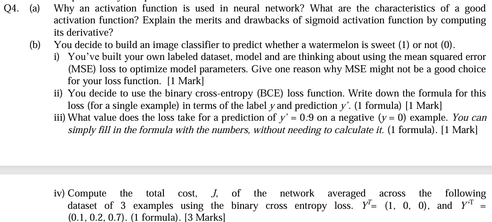

### C-Q4 (a) – Activation function: need, characteristics, sigmoid

**Why needed.** Without a non-linearity, a stack of layers collapses to one linear map: $W_2(W_1x)=(W_2W_1)x$. The activation introduces **non-linearity** so the network can approximate any function (universal approximation) and it also bounds/normalises outputs.

**Characteristics of a good activation function**

1. Non-linear.
2. Differentiable (at least almost everywhere) so back-prop works.
3. Non-saturating / gradient does not vanish (derivative not ≈ 0 over a large range).
4. Zero-centred (or nearly) output → faster convergence.
5. Monotonic, with a derivative that is cheap to compute.
6. Preferably bounded or well-scaled outputs and computationally cheap.

**Sigmoid** $\sigma(z)=\dfrac1{1+e^{-z}}$ — derivative:

$$
\sigma'(z)=\frac{d}{dz}(1+e^{-z})^{-1}=\frac{e^{-z}}{(1+e^{-z})^{2}}
=\frac1{1+e^{-z}}\cdot\frac{e^{-z}}{1+e^{-z}}=\sigma(z)\,\big(1-\sigma(z)\big)
$$

Maximum at $z=0$: $\sigma'(0)=0.25$; $\sigma'(\pm5)\approx0.0066$; $\sigma'\to0$ as $\lvert z\rvert\to\infty$.

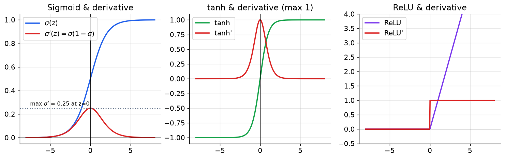

| Merits | Drawbacks |
|---|---|
| Smooth, differentiable everywhere | **Saturates** for large $\lvert z\rvert$: $\sigma'\to0$ → **vanishing gradient** ($\sigma'\le0.25$ so the product over layers shrinks like $0.25^L$) |
| Output in (0,1): interpretable as a probability (binary output layer) | Output **not zero-centred** → all gradients of a layer's weights share a sign → zig-zag updates, slower convergence |
| Derivative expressed through the output, $\sigma(1-\sigma)$ → cheap in back-prop | Uses $\exp$, more expensive than ReLU |
| Squashes outputs; historically biologically motivated | Neurons that saturate stop learning |

### C-Q4 (b) – Watermelon classifier (sweet = 1 / not = 0)

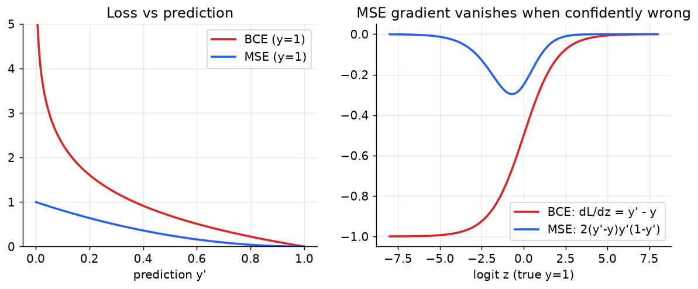

**i) Why MSE may be a poor choice (one reason).** With a sigmoid output $\hat y=\sigma(z)$, the MSE gradient is $\partial L/\partial z=2(\hat y-y)\hat y(1-\hat y)$; when the prediction is confidently *wrong* ($\hat y\to0$ while $y=1$) the factor $\hat y(1-\hat y)\to0$, so the gradient **vanishes** and learning is very slow. (The loss surface is also non-convex in the weights for classification.) BCE's gradient is simply $\hat y-y$.

**ii) Binary cross-entropy (one example)**

$$
\boxed{L(y,y')=-\big[\,y\log y'+(1-y)\log(1-y')\,\big]}
$$

**iii) $y'=0.9$ for a negative example ($y=0$)**

$$
L=-\big[0\cdot\log0.9+(1-0)\log(1-0.9)\big]=-\log(0.1)\;\approx\;2.303
$$

**iv) Total cost for $Y=(1,0,0)$, $Y'=(0.1,0.2,0.7)$**

$$
J=-\frac1m\sum_{i=1}^{m}\big[y_i\log y'_i+(1-y_i)\log(1-y'_i)\big]
$$

| $i$ | $y$ | $y'$ | Loss |
|---|---|---|---|
| 1 | 1 | 0.1 | $-\log0.1=2.3026$ |
| 2 | 0 | 0.2 | $-\log0.8=0.2231$ |
| 3 | 0 | 0.7 | $-\log0.3=1.2040$ |
| **Sum** | | | 3.7297 |

$$
J=\frac{3.7297}{3}=\boxed{1.2432}
$$

(natural logarithm used.)

---

## C-Q5

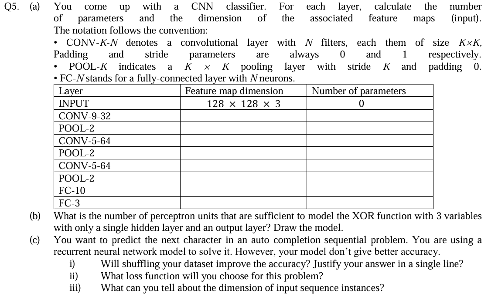

### C-Q5 (a) – Feature-map dimension and parameters

Padding 0, stride 1 for CONV → $W_2=W_1-K+1$; POOL-$K$ uses a $K\times K$ window with stride $K$ → $W_2=W_1/K$. CONV params $=(K\cdot K\cdot D_{in}+1)N$; POOL params $=0$; FC params $=(n_{in}+1)N$.

| Layer | Feature-map dimension | Number of parameters |
|---|---|---|
| INPUT | 128 × 128 × 3 | 0 |
| CONV-9-32 | 120 × 120 × 32 | (9·9·3 + 1)·32 = 244·32 = **7,808** |
| POOL-2 | 60 × 60 × 32 | 0 |
| CONV-5-64 | 56 × 56 × 64 | (5·5·32 + 1)·64 = 801·64 = **51,264** |
| POOL-2 | 28 × 28 × 64 | 0 |
| CONV-5-64 | 24 × 24 × 64 | (5·5·64 + 1)·64 = 1601·64 = **102,464** |
| POOL-2 | 12 × 12 × 64 | 0 |
| FC-10 | 10 | (12·12·64 + 1)·10 = 9217·10 = **92,170** |
| FC-3 | 3 | (10 + 1)·3 = **33** |
| **Total** | | **253,739** |

Flatten before FC-10: $12\cdot12\cdot64=9216$.

### C-Q5 (b) – XOR of 3 variables with one hidden layer

3-bit XOR (parity) $=1$ when an **odd** number of inputs are 1; it is not linearly separable, so a hidden layer is required.

**Construction.** Hidden unit $h_i$ fires when at least $i$ inputs are on:

$$
h_i=\mathbb 1\big[x_1+x_2+x_3\ge i\big],\quad i=1,2,3\qquad(\text{weights }1,1,1;\ \text{thresholds }1,2,3)
$$

Output: $y=\mathbb 1\big[h_1-h_2+h_3-0.5\ge0\big]$ (weights $+1,-1,+1$, bias $-0.5$).

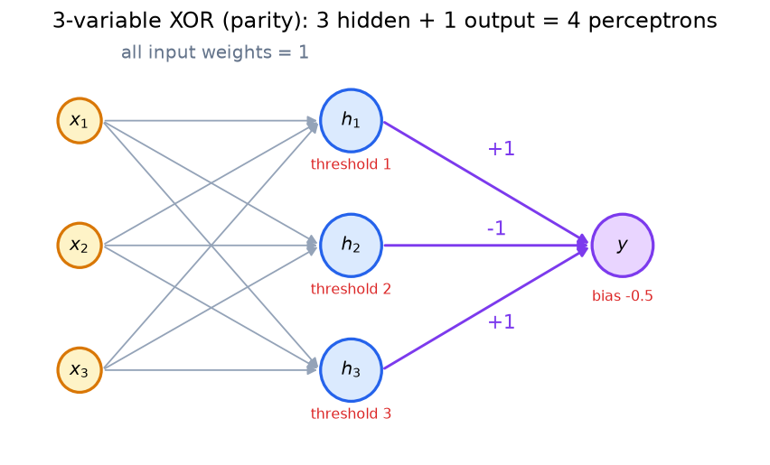

| $\sum x_i$ | $h_1h_2h_3$ | $h_1-h_2+h_3$ | $y$ |
|---|---|---|---|
| 0 | 0 0 0 | 0 | 0 |
| 1 | 1 0 0 | 1 | 1 |
| 2 | 1 1 0 | 0 | 0 |
| 3 | 1 1 1 | 1 | 1 |

**Answer:** 3 hidden perceptrons + 1 output perceptron = **4 perceptron units** (in general $n$ hidden units for $n$-bit parity).

### C-Q5 (c) – Next-character prediction with an RNN

i) **Will shuffling improve accuracy? No.** Order carries the information in a sequence; shuffling the characters destroys the dependencies the RNN must learn (shuffling whole independent sequences between epochs is harmless but does not fix accuracy).

ii) **Loss: categorical cross-entropy over a softmax output** (multi-class classification over the character vocabulary $V$):

$$
L=-\sum_{t}\log P\big(y_t=\text{true next char}\mid x_{1:t}\big)=-\sum_t\sum_{c\in V}y_{t,c}\log\hat y_{t,c}
$$

iii) **Dimension of the input sequence.** Each character is a one-hot vector of size $\lvert V\rvert$ (or a fixed-size embedding), so one instance has shape $T\times\lvert V\rvert$ ($T$ = sequence length). The input size $k=\lvert V\rvert$ is the same at every time step; sequences can have different lengths (padded/truncated per batch); the output at each step is also $\lvert V\rvert$-dimensional. A batch is $B\times T\times\lvert V\rvert$.

---

## C-Q6

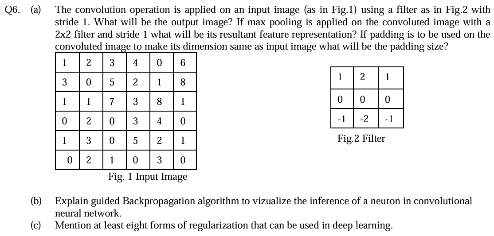

### C-Q6 (a) – Convolution, max-pooling and padding

**Input (6×6)** and **filter (3×3)**:

$$
I=\begin{bmatrix}1&2&3&4&0&6\\3&0&5&2&1&8\\1&1&7&3&8&1\\0&2&0&3&4&0\\1&3&0&5&2&1\\0&2&1&0&3&0\end{bmatrix},\qquad
F=\begin{bmatrix}1&2&1\\0&0&0\\-1&-2&-1\end{bmatrix}
$$

Output size $=\dfrac{6-3}{1}+1=4$ → **4×4**. (Cross-correlation, i.e. no kernel flip – the usual CNN convention. A true convolution flips the filter 180°, which negates every value.)

Because the middle row of $F$ is zero, each output is a difference of two weighted row-sums. Define for every image row $r$: $T_r[c]=r[c]+2r[c+1]+r[c+2]$ ($c=1..4$), then output row $i$ $=T_i-T_{i+2}$.

| Row | $T$ |
|---|---|
| R1 | [8, 12, 11, 10] |
| R2 | [8, 12, 10, 12] |
| R3 | [10, 18, 21, 20] |
| R4 | [4, 5, 10, 11] |
| R5 | [7, 8, 12, 10] |
| R6 | [5, 4, 4, 6] |

Output row 1 $=$ R1 − R3 $=$ [8−10, 12−18, 11−21, 10−20]; row 2 $=$ R2 − R4; row 3 $=$ R3 − R5; row 4 $=$ R4 − R6:

$$
\text{Conv output}=\begin{bmatrix}-2&-6&-10&-10\\4&7&0&1\\3&10&9&10\\-1&1&6&5\end{bmatrix}
$$

Spot check of the first entry: $(1\cdot1+2\cdot2+1\cdot3)+(-1\cdot1-2\cdot1-1\cdot7)=8-10=-2$ ✓.

**Max-pooling (2×2, stride 1)** → $(4-2)/1+1=3$ → **3×3**:

$$
\text{Pooled}=\begin{bmatrix}7&7&1\\10&10&10\\10&10&10\end{bmatrix}
$$

e.g. $\max(-2,-6,4,7)=7$, $\max(-6,-10,7,0)=7$, $\max(-10,-10,0,1)=1$, $\max(4,7,3,10)=10$, …

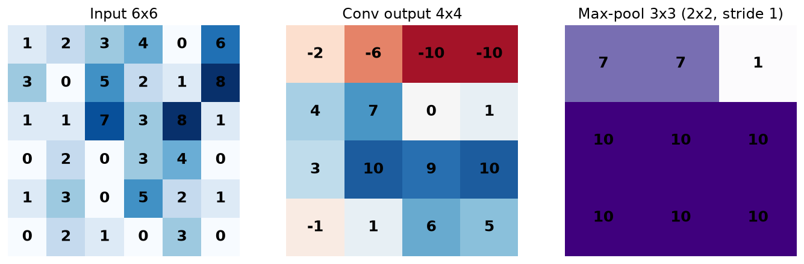

**Padding to bring the convolved image back to the input size.** Convolved image is 4×4, the input is 6×6: $4+2P=6\Rightarrow\boxed{P=1}$ (one row/column of zeros on every side). Equivalently, for the original convolution to keep size: $(6-3+2P)/1+1=6\Rightarrow P=1$ ("same" padding, $P=(F-1)/2$).

> **Note.** The earlier Word answer file listed the convolution result as `[-2 7 1 -1; 4 7 -2 1; 6 13 11 9; -3 4 8 4]` and the pooled result `[7 7 1; 13 13 11; 13 13 11]`. The row-subtraction in it was wrong (e.g. R1−R3 = 8−10 = −2, 12−18 = **−6**, not 7). The values above were recomputed in code and are correct.

### C-Q6 (b) – Guided back-propagation

Purpose: visualise which input pattern (pixels) a chosen neuron in a CNN responds to. It combines normal back-propagation with the "deconvnet" rule at every ReLU.

**Steps**

1. Forward pass the image and store the activations up to the layer of the target neuron.
2. Set the gradient/signal at the target neuron to 1 (zero for every other unit in the layer).
3. Back-propagate to the input. At each ReLU apply a **double mask**:

$$
R^{l}=\underbrace{\mathbb 1[f^{l}>0]}_{\text{forward activation was positive}}\cdot\underbrace{\mathbb 1[R^{l+1}>0]}_{\text{incoming gradient is positive}}\cdot R^{l+1}
$$

4. The result in input space shows the pixels that **positively excite** the neuron.

| Method | Rule at ReLU |
|---|---|
| Normal back-prop | $R^l=\mathbb 1[f^l>0]\,R^{l+1}$ |
| Deconvnet | $R^l=\mathbb 1[R^{l+1}>0]\,R^{l+1}$ |
| **Guided back-prop** | $R^l=\mathbb 1[f^l>0]\,\mathbb 1[R^{l+1}>0]\,R^{l+1}$ |

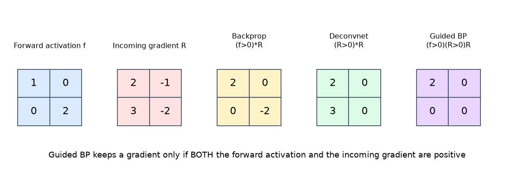

*Why it works:* removing negative gradients throws away evidence that *suppresses* the neuron, giving sharp, clean pictures of the edges/parts the neuron detects. No re-training is needed.

### C-Q6 (c) – At least eight forms of regularisation

| # | Technique | Idea / formula |
|---|---|---|
| 1 | **L2 (weight decay / ridge)** | $L'=L+\lambda\lVert w\rVert_2^2$; shrinks weights, update $w\leftarrow(1-2\eta\lambda)w-\eta\nabla L$ |
| 2 | **L1 (lasso)** | $L'=L+\lambda\lVert w\rVert_1$; produces **sparse** weights |
| 3 | **Elastic net** | $L+\lambda_1\lVert w\rVert_1+\lambda_2\lVert w\rVert_2^2$ |
| 4 | **Dropout** | randomly deactivate units/weights with probability $p$ during training |
| 5 | **Early stopping** | stop when the validation loss starts to rise |
| 6 | **Data augmentation** | flips, crops, rotations, colour jitter, noise |
| 7 | **Batch normalisation** | mini-batch noise in mean/variance gives a mild regularising effect |
| 8 | **Noise injection** | add noise to inputs, weights or labels |
| 9 | **Label smoothing** | soft targets $y=(1-\varepsilon)\,\text{one-hot}+\varepsilon/C$ |
| 10 | **Parameter sharing / tying** | as in CNNs and RNNs |
| 11 | **Ensembling / bagging** | average several models |
| 12 | **Max-norm constraint & gradient clipping** | $\lVert w\rVert\le c$ |

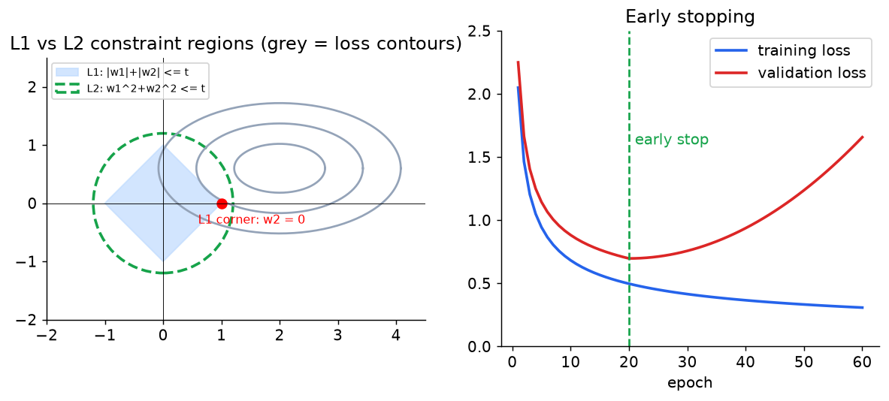

---

<a id="paper-d"></a>
# Paper D

## D-Q1


### D-Q1 (a) – Loss function for classification (with definition)

The standard loss for classification is the **cross-entropy loss** (log loss), the negative log-likelihood of the true class.

**Binary** (label $y\in\{0,1\}$, predicted probability $\hat y=\sigma(z)$):

$$
\boxed{L(y,\hat y)=-\big[\,y\log\hat y+(1-y)\log(1-\hat y)\,\big]}
$$

**Multi-class** ($K$ classes, one-hot $y$, softmax output $\hat y_k=\dfrac{e^{z_k}}{\sum_j e^{z_j}}$):

$$
\boxed{L=-\sum_{k=1}^{K}y_k\log\hat y_k}
$$

**Cost over $N$ examples:** $J=\dfrac1N\sum_{i=1}^{N}L\big(y^{(i)},\hat y^{(i)}\big)$.

Why it is used: it is the maximum-likelihood loss for a Bernoulli/categorical output, it heavily penalises confident wrong predictions ($\hat y\to0$ when $y=1$ gives $L\to\infty$), and with sigmoid/softmax its gradient is simply $\partial L/\partial z=\hat y-y$ (no vanishing factor, unlike MSE).

### D-Q1 (b) – McCulloch–Pitts neuron for 3-bit OR

MP neuron: binary inputs, all excitatory weights $=+1$, output $y=1$ iff $\sum x_i\ge\theta$. OR fires when **at least one** input is 1, so $\theta=1$.


$$
y=\begin{cases}1&x_1+x_2+x_3\ge1\0&\text{otherwise}\end{cases}\qquad(w_1=w_2=w_3=1,\ \theta=1)
$$

| $x_1x_2x_3$ | 000 | 001 | 010 | 011 | 100 | 101 | 110 | 111 |
|---|---|---|---|---|---|---|---|---|
| $\sum$ | 0 | 1 | 1 | 2 | 1 | 2 | 2 | 3 |
| $y$ | **0** | 1 | 1 | 1 | 1 | 1 | 1 | 1 |

(The figure above shows $\theta=3$ for AND; for OR simply change the threshold to 1.)

### D-Q1 (c) – Weight-update equations

Let $g_t=\nabla_wL(w_t)$, learning rate $\eta$, $\epsilon\approx10^{-8}$.

**i) Adam** (momentum + RMSProp with bias correction; $\beta_1\approx0.9,\ \beta_2\approx0.999$)

$$
m_t=\beta_1m_{t-1}+(1-\beta_1)g_t,\qquad v_t=\beta_2v_{t-1}+(1-\beta_2)g_t^{2},\qquad m_0=v_0=0
$$

$$
\hat m_t=\frac{m_t}{1-\beta_1^{\,t}},\qquad \hat v_t=\frac{v_t}{1-\beta_2^{\,t}},\qquad
\boxed{w_{t+1}=w_t-\frac{\eta}{\sqrt{\hat v_t}+\epsilon}\,\hat m_t}
$$

* $m_t$ = running mean of gradients (direction / momentum); $v_t$ = running mean of squared gradients (per-weight adaptive step size).
* Bias correction fixes the start-up bias towards 0; it tends to 1 as $t\to\infty$.

**ii) NAG – Nesterov Accelerated Gradient** (look-ahead momentum; $\gamma\approx0.9$)

$$
v_t=\gamma v_{t-1}+\eta\,\nabla_wL\big(w_t-\gamma v_{t-1}\big),\qquad
\boxed{w_{t+1}=w_t-v_t}
$$

* First take the momentum step to the look-ahead point $w_t-\gamma v_{t-1}$, **then** compute the gradient there and correct. This anticipates where the weights are going, reduces overshoot/oscillation and converges faster than plain momentum.

### D-Q1 (d) – Characteristics of a sequential learning problem

1. **Order matters** – data are ordered (time series, text, speech, DNA); shuffling inside a sequence destroys information.
2. **Temporal / long-range dependence** – output at step $t$ depends on the current *and past* inputs, so memory/state is required.
3. **Variable-length** inputs and/or outputs (padding / masking needed).
4. **Parameter sharing across time** – the same weights are applied at every time step.
5. **Samples are not i.i.d.** (neighbours are correlated); trained with back-propagation through time.
6. Modes: one-to-many, many-to-one, many-to-many.

---

## D-Q2

### D-Q2 (a) – Which statements are true?

| # | Statement | Verdict | Reason |
|---|---|---|---|
| a | Complex models have high bias and low variance. | **False** | Complex models have **low bias and high variance** (they over-fit). High bias / low variance belongs to *simple* models. |
| b | In overfitting train error is low while test error is high. | **True** | The model memorises the training data (low train error) but does not generalise (high test error). |
| c | Both bias and variance contribute to error. | **True** | $\mathrm{Err}=\mathrm{Bias}^2+\mathrm{Variance}+\sigma^2$ (irreducible noise). |
| d | Pooling is used to detect edges. | **False** | Edges are detected by **convolution filters** (e.g. Sobel-like kernels). Pooling **down-samples** the feature map, reduces computation and gives small translation invariance. |

**Answer: b and c are true.**

### D-Q2 (b) – CNN block on a $128\times128\times16$ input

Notation $(H,W,C)$; convolutions use stride 1 (not stated), padding 0.

**i) CONV4-32** (32 filters, $4\times4$)

$$
H_2=W_2=\frac{128-4+0}{1}+1=125,\quad C_2=32\;\Rightarrow\;\boxed{(125,125,32)}
$$

$$
\text{Params}=(4\cdot4\cdot16+1)\cdot32=257\cdot32=\boxed{8{,}224}\quad(8{,}192\ \text{weights}+32\ \text{biases})
$$

**ii) POOL4** ($4\times4$ max-pool, stride 2, padding 0) on $(125,125,32)$

$$
H=W=\left\lfloor\frac{125-4}{2}\right\rfloor+1=\lfloor60.5\rfloor+1=61\;\Rightarrow\;\boxed{(61,61,32)},\qquad\text{Params}=\boxed{0}
$$

(pooling has no learnable parameters; channels unchanged.)

**iii) CONV2-16** (16 filters, $2\times2$) on $(61,61,32)$

$$
H_2=W_2=\frac{61-2+0}{1}+1=60,\quad C_2=16\;\Rightarrow\;\boxed{(60,60,16)}
$$

$$
\text{Params}=(2\cdot2\cdot32+1)\cdot16=129\cdot16=\boxed{2{,}064}\quad(2{,}048\ \text{weights}+16\ \text{biases})
$$

| Layer | Output | Parameters |
|---|---|---|
| Input | (128, 128, 16) | 0 |
| CONV4-32 | (125, 125, 32) | 8,224 |
| POOL4 | (61, 61, 32) | 0 |
| CONV2-16 | (60, 60, 16) | 2,064 |
| **Total** | | **10,288** |

---

## D-Q3

### D-Q3 (a) – Short note on LSTM, with the gate equations

An **LSTM** (Long Short-Term Memory) is an RNN cell with a separate **cell state** $c_t$ (a "conveyor belt") that is changed only by additive, gated updates. This lets gradients flow over many time steps, so it mitigates the vanishing-gradient problem of a plain RNN and learns long-range dependencies.


Let $z_t=[h_{t-1},x_t]$ (concatenation), $\sigma$ = sigmoid, $\odot$ = element-wise product.

| Gate | Equation | Function |
|---|---|---|
| **Forget gate** | $f_t=\sigma(W_fz_t+b_f)$ | how much of the old cell state $c_{t-1}$ to keep |
| **Input gate** | $i_t=\sigma(W_iz_t+b_i)$ | how much of the new candidate to write |
| **Candidate state** | $\tilde c_t=\tanh(W_cz_t+b_c)$ | new information proposal |
| **Output gate** | $o_t=\sigma(W_oz_t+b_o)$ | how much of the cell to expose as $h_t$ |

$$
c_t=f_t\odot c_{t-1}+i_t\odot\tilde c_t,\qquad h_t=o_t\odot\tanh(c_t)
$$

Because $\partial c_t/\partial c_{t-1}=f_t$ (no repeated squashing by $W$ and $\tanh'$), gradients do not vanish when $f_t\approx1$. Uses: language modelling, translation, speech, time series.

### D-Q3 (b) – Perceptron convergence theorem

**Claim.** If $P$ (positive) and $N$ (negative) are finite and linearly separable, the perceptron algorithm updates $w_t$ only a finite number of times.

**Setup.** Replace every $x\in N$ by $-x$ and let $P'=P\cup N^-$. Now we need $w$ with $w\cdot x>0$ for all $x\in P'$. Let $R=\max\lVert x\rVert$ (finite set). Algorithm: if $w_t\cdot x\le0$ for some $x\in P'$, set $w_{t+1}=w_t+x$ (start $w_0=0$).

Since the sets are linearly separable, there is a unit vector $w^*$ and margin $\gamma>0$ with $w^*\cdot x\ge\gamma$ for all $x\in P'$.

**Step 1 – the projection on $w^*$ grows linearly.** After $k$ updates

$$
w_{k}\cdot w^*=w_{k-1}\cdot w^*+x\cdot w^*\;\ge\;w_{k-1}\cdot w^*+\gamma\;\Rightarrow\;w_k\cdot w^*\ge k\gamma
$$

**Step 2 – the norm grows at most like $\sqrt k$.** An update only happens when $w_{k-1}\cdot x\le0$:

$$
\lVert w_k\rVert^2=\lVert w_{k-1}\rVert^2+2\,w_{k-1}\cdot x+\lVert x\rVert^2\;\le\;\lVert w_{k-1}\rVert^2+R^2\;\Rightarrow\;\lVert w_k\rVert^2\le kR^2
$$

**Step 3 – combine** (Cauchy–Schwarz, $\lVert w^*\rVert=1$):

$$
k\gamma\le w_k\cdot w^*\le\lVert w_k\rVert\le\sqrt k\,R\;\Rightarrow\;\boxed{k\le\frac{R^2}{\gamma^2}}
$$

So the number of updates is bounded by $R^2/\gamma^2$ – **finite**. After the last update every point is classified correctly, i.e. $P$ and $N$ are separated. $\blacksquare$

---

## D-Q4

### D-Q4 (a) – ReLU, its derivative, the problem, and Leaky ReLU

**ReLU:** $f(x)=\max(0,x)$.

$$
f'(x)=\begin{cases}1&x>0\\0&x<0\end{cases}\qquad(\text{at }x=0\text{ undefined; taken as }0\text{ or }1)
$$

Advantages: cheap, no saturation for $x>0$ (gradient is exactly 1, so no vanishing gradient), sparse activations, fast convergence.

**Problem – dying ReLU.** For $x<0$ the output **and gradient are 0**. If a large update (e.g. a big learning rate) pushes a neuron's pre-activation negative for all inputs, then $\partial L/\partial w=0$ for it, its weights never change again and the neuron is permanently "dead". Also the output is not zero-centred.

**Leaky ReLU** keeps a small slope for negative inputs:

$$
f(x)=\begin{cases}x&x>0\\\alpha x&x\le0\end{cases},\qquad f'(x)=\begin{cases}1&x>0\\\alpha&x\le0\end{cases}\quad(\alpha\approx0.01)
$$

Since the gradient for $x<0$ is $\alpha\neq0$, the weights of such a neuron still get (small) updates and it can recover – no dead neurons. (Parametric ReLU learns $\alpha$.)

### D-Q4 (b)

**i) Parameters (6 inputs, 1 hidden layer of 5 neurons, 2 outputs, bias at each neuron) [2]**

$$
\text{Hidden: }(6+1)\cdot5=35,\qquad \text{Output: }(5+1)\cdot2=12,\qquad \boxed{\text{Total}=35+12=47}
$$

(weights $6\cdot5+5\cdot2=40$, biases $5+2=7$.)

**ii) How train / validation / test splitting reveals overfitting [2]**

* **Train set** – used to learn the weights.
* **Validation set** – used during training to tune hyper-parameters and monitor generalisation (early stopping).
* **Test set** – touched once at the end for an unbiased estimate of the final performance.

Plot train and validation loss against epochs: if the **training error keeps falling but the validation (test) error starts to rise** (large train–validation gap), the model is memorising the training data → **overfitting**. Training error alone always looks good, so a single set cannot show this. Remedies: more data, regularisation, dropout, early stopping, simpler model.

**iii) Step function $f(x)=1$ if $x\ge0$, else $0$ as the non-linearity with SGD [2]**

**No, I would not follow the advice.** SGD updates weights using gradients obtained by back-propagation, which needs $f'(x)$. For the step function

$$
f'(x)=0\ \ \text{for all }x\neq0\ \ (\text{undefined at }0)
$$

so the gradient passed to every earlier layer is $0$, i.e. $\partial L/\partial w=0$: the weights never change and **the network cannot learn** (the surface is flat and gives no direction that reduces the loss). It also gives only a binary output with no notion of "how far". Use ReLU / Leaky ReLU (or sigmoid/tanh) instead – differentiable (almost everywhere) with a useful non-zero gradient.

---

## D-Q5

### D-Q5 (a) – Architecture of LeNet-5 with hyper-parameters


Input: $32\times32\times1$ grayscale image (MNIST padded). $F$ = filter size, $S$ = stride, $P$ = padding, $K$ = number of filters.

| Layer | Type | Hyper-parameters | Output | Parameters |
|---|---|---|---|---|
| INPUT | image | – | 32×32×1 | 0 |
| C1 | Conv | $K=6,\ F=5,\ S=1,\ P=0$, tanh | 28×28×6 | 156 |
| S2 | Avg-pool | $F=2,\ S=2$ | 14×14×6 | 0 (12 in original) |
| C3 | Conv | $K=16,\ F=5,\ S=1,\ P=0$, tanh | 10×10×16 | 2,416 (1,516 sparse) |
| S4 | Avg-pool | $F=2,\ S=2$ | 5×5×16 | 0 |
| C5 | Conv (=FC) | $K=120,\ F=5,\ S=1$ | 1×1×120 | 48,120 |
| F6 | FC | 84 units, tanh | 84 | 10,164 |
| OUTPUT | FC | 10 units, softmax/RBF | 10 | 850 |
| **Total** | | | | **≈ 61,706** |

Flow: $32\times32\to28\times28\to14\times14\to10\times10\to5\times5\to1\times1\to84\to10$, using $W_2=\frac{W_1-F+2P}{S}+1$ and conv params $K(F^2D+1)$.

### D-Q5 (b) – MLP for 3-variable XOR with one hidden layer

3-bit XOR (parity) $=1$ when an **odd** number of inputs are 1; it is not linearly separable, so a hidden layer is required.

Hidden unit $h_i$ fires when at least $i$ inputs are on:

$$
h_i=\mathbb 1\big[x_1+x_2+x_3\ge i\big],\quad i=1,2,3\qquad(\text{weights }1,1,1;\ \text{thresholds }1,2,3)
$$

Output: $y=\mathbb 1\big[h_1-h_2+h_3-0.5\ge0\big]$ (weights $+1,-1,+1$, bias $-0.5$).


| $\sum x_i$ | $h_1h_2h_3$ | $h_1-h_2+h_3$ | $y$ |
|---|---|---|---|
| 0 | 0 0 0 | 0 | 0 |
| 1 | 1 0 0 | 1 | 1 |
| 2 | 1 1 0 | 0 | 0 |
| 3 | 1 1 1 | 1 | 1 |

**Network:** 3 inputs → 3 hidden perceptrons → 1 output perceptron.

### D-Q5 (c) – Why moving against the gradient minimises the function; back-propagation

**Proof.** Take a small step of size $\eta$ in a unit direction $u$ from $w$. By the first-order Taylor expansion

$$
L(w+\eta u)\approx L(w)+\eta\,\nabla L(w)\cdot u
$$

The change in loss is $\eta\,\nabla L\cdot u=\eta\lVert\nabla L\rVert\cos\theta$, where $\theta$ is the angle between $u$ and $\nabla L$. It is **most negative when $\cos\theta=-1$**, i.e. $u=-\nabla L/\lVert\nabla L\rVert$ (the direction opposite to the gradient). Hence the update

$$
\boxed{w_{t+1}=w_t-\eta\,\nabla L(w_t)}\ \Rightarrow\ L(w_{t+1})\approx L(w_t)-\eta\lVert\nabla L(w_t)\rVert^2\le L(w_t)
$$

so the loss decreases for small $\eta>0$ (until $\nabla L=0$, a minimum). $\blacksquare$

**Back-propagation with the gradient-descent rule.**

1. **Forward pass:** for layer $l$: $z^{(l)}=W^{(l)}a^{(l-1)}+b^{(l)}$, $a^{(l)}=f(z^{(l)})$; compute the loss $L$ at the output.
2. **Output error:** $\delta^{(L)}=\dfrac{\partial L}{\partial a^{(L)}}\odot f'(z^{(L)})$ (sigmoid + MSE: $\delta=(y-t)\,y(1-y)$).
3. **Propagate backwards (chain rule):** $\delta^{(l)}=\big(W^{(l+1)T}\delta^{(l+1)}\big)\odot f'(z^{(l)})$.
4. **Gradients:** $\dfrac{\partial L}{\partial W^{(l)}}=\delta^{(l)}\,a^{(l-1)T},\qquad \dfrac{\partial L}{\partial b^{(l)}}=\delta^{(l)}$.
5. **Gradient-descent update:** $W^{(l)}\leftarrow W^{(l)}-\eta\,\delta^{(l)}a^{(l-1)T},\quad b^{(l)}\leftarrow b^{(l)}-\eta\,\delta^{(l)}$.
6. Repeat over mini-batches/epochs until the loss converges.

Back-propagation is the chain rule applied layer by layer from the output, re-using the $\delta$ of the next layer, so all gradients come from one backward sweep.

---

## D-Q6

(Question number not visible in the screenshot; parts (b) and (c) are numbered here as Q6.)

### D-Q6 (b) – Transfer learning and its cases [3]

**Transfer learning** means re-using the knowledge (learned weights/features) of a model trained on a large **source** task/dataset (e.g. ImageNet) to solve a different but related **target** task, usually with little data. Early layers learn generic features (edges, textures) that are useful across tasks, so we do not train from scratch. Benefits: less data, less training time, better accuracy, less over-fitting.

**Cases** (depend on the size of the target dataset and its similarity to the source):

| Case | Target data | Similarity to source | What to do |
|---|---|---|---|
| 1 | Small | High (similar) | Freeze all conv layers, use the network as a **fixed feature extractor**, train only a new classifier (linear/softmax) on top. Fine-tuning would over-fit. |
| 2 | Small | Low (different) | Take features from **earlier/generic layers** only (later layers are source-specific), train a new classifier (e.g. SVM) on them; or use heavy augmentation. |
| 3 | Large | High (similar) | **Fine-tune** the whole network (or most layers) starting from the pre-trained weights, with a small learning rate. |
| 4 | Large | Low (different) | Pre-trained weights are only used as **initialisation**; fine-tune/retrain the whole network (or train from scratch). |

Other common forms: **feature extraction** (freeze) vs **fine-tuning** (unfreeze some/all layers); by task type – *inductive* (target labelled), *transductive* (same task, different domain – domain adaptation), *unsupervised* transfer.

Typical procedure: load pre-trained model → remove the last layer → add a new layer for the target classes → freeze early layers → train → optionally unfreeze deeper layers and fine-tune with a low learning rate.

### D-Q6 (c) – Advantages of skip connections

A **skip (shortcut) connection** adds the input of a block to its output, e.g. in ResNet $y=\mathcal F(x,\{W_i\})+x$, or concatenates earlier feature maps (DenseNet, U-Net).

1. **Mitigates vanishing gradients:** $\dfrac{\partial y}{\partial x}=\dfrac{\partial\mathcal F}{\partial x}+1$, so the gradient always has an identity path back to earlier layers and does not shrink to zero – very deep networks (50–1000 layers) can be trained.
2. **Solves the degradation problem:** a deeper plain net can have higher training error; with skip connections a block can learn the identity ($\mathcal F\to0$) easily, so extra layers do not hurt.
3. **Easier optimisation / faster convergence:** the block only learns the *residual* $\mathcal F(x)=H(x)-x$, which is easier than learning the full mapping; the loss surface is smoother.
4. **Feature re-use and information flow:** low-level (fine, spatial) features are passed directly to later layers; in U-Net skips restore spatial detail lost by down-sampling.
5. **Better accuracy / generalisation** with no extra parameters and almost no extra computation (the identity shortcut is parameter-free).

---

## D-Q7

(Numbered 4(a), 4(b) in the newest screenshot; shown here as D-Q7.)

### D-Q7 (a) – Encoder–Decoder (seq2seq) architecture

**Idea.** Two networks (RNN/LSTM/GRU, or Transformer blocks) joined by a fixed-size summary:

* **Encoder** reads the input sequence $x_1,\dots,x_T$ one token at a time and compresses it into a **context vector** $c$ (the final hidden state): $h_t=f(h_{t-1},x_t),\ c=h_T$.
* **Decoder** is initialised with $c$ and generates the output sequence $y_1,\dots,y_{T'}$ one token at a time: $s_t=g(s_{t-1},y_{t-1},c),\ P(y_t\mid y_{<t},x)=\text{softmax}(W s_t)$, starting from a `<sos>` token and stopping when it emits `<eos>`.

$$
P(y_1,\dots,y_{T'}\mid x_1,\dots,x_T)=\prod_{t=1}^{T'}P(y_t\mid y_{<t},c)
$$

**Variable-length input and output.** The encoder loops for as many steps as the input has tokens (any $T$) and always ends with a fixed-size vector $c$; the decoder loops until it produces `<eos>` (any $T'$). Input and output lengths are therefore independent ($T\ne T'$ is fine). In batches, sequences are padded to the same length and masked. **Attention** removes the fixed-vector bottleneck: at each step the decoder uses $c_t=\sum_i\alpha_{ti}h_i$ with weights $\alpha_{ti}=\text{softmax}(\text{score}(s_{t-1},h_i))$, which helps for long sentences.

**Example – machine translation (English → French):**

| | |
|---|---|
| Input | "I love deep learning" (4 tokens) |
| Encoder | processes `I`, `love`, `deep`, `learning` → context $c$ |
| Decoder | `<sos>` → "J'" → "aime" → "l'apprentissage" → "profond" → `<eos>` |
| Output | "J'aime l'apprentissage profond" (different length, different word order) |

Other uses: summarisation, speech recognition, image captioning (CNN encoder + RNN decoder), chatbots.

### D-Q7 (b) – Positional encoding in Transformers

**Role.** Positional encoding injects information about the **order/position** of each token into its embedding, so the model knows *where* a word is: $\text{input}_t=\text{embedding}(x_t)+PE(t)$.

**Why self-attention alone cannot see order.** Self-attention $\text{softmax}\!\big(QK^T/\sqrt{d_k}\big)V$ treats the input as an unordered **set**: it is *permutation-equivariant* – if the tokens are shuffled, the outputs are just shuffled in the same way, and each token's output (a weighted sum over all tokens) does not depend on where the others sit. Unlike an RNN (which reads left-to-right) or a CNN (local windows), nothing in it encodes position. Hence "dog bites man" and "man bites dog" would get the same bag of representations.

**Sinusoidal encoding** (Vaswani et al.), position $pos$, dimension index $i$:

$$
PE_{(pos,2i)}=\sin\!\Big(\frac{pos}{10000^{2i/d}}\Big),\qquad PE_{(pos,2i+1)}=\cos\!\Big(\frac{pos}{10000^{2i/d}}\Big)
$$

Each position gets a unique vector; different dimensions have different wavelengths; relative offsets $PE_{pos+k}$ are a linear function of $PE_{pos}$ (easy for attention to learn relative position) and it extends to longer sequences. (Learned positional embeddings, relative or rotary encodings are alternatives.)

**Illustration** ($d=4$): for the sentence "The cat sat",

| pos | $\sin(pos/1)$ | $\cos(pos/1)$ | $\sin(pos/100)$ | $\cos(pos/100)$ |
|---|---|---|---|---|
| 0 (The) | 0 | 1 | 0 | 1 |
| 1 (cat) | 0.841 | 0.540 | 0.010 | 1.000 |
| 2 (sat) | 0.909 | −0.416 | 0.020 | 1.000 |

Without PE, "cat sat The" would produce the same set of vectors; with PE the three words get different position-dependent vectors, so the order "The cat sat" is distinguishable from "sat cat The".

---

## D-Q8

### D-Q8 (a) – GAN architecture, limitations of vanilla GAN, DCGAN and CycleGAN

**Architecture.** Two networks play a minimax game:

* **Generator $G(z)$** – maps random noise $z\sim p_z$ to a fake sample.
* **Discriminator $D(x)$** – outputs the probability that $x$ is real (from the data) rather than generated.

$$
\min_G\max_D\ V(D,G)=\mathbb E_{x\sim p_{data}}[\log D(x)]+\mathbb E_{z\sim p_z}[\log(1-D(G(z)))]
$$

Training alternates: update $D$ to tell real from fake, update $G$ to fool $D$ (in practice maximise $\log D(G(z))$). At the optimum $p_g=p_{data}$ and $D(x)=\tfrac12$.

**Limitations of the vanilla GAN**

1. **Training instability / non-convergence** – the two players oscillate; no stable equilibrium.
2. **Mode collapse** – $G$ produces only a few kinds of samples.
3. **Vanishing gradients** – if $D$ becomes too good, $\log(1-D(G(z)))$ saturates and $G$ gets no gradient.
4. **No useful loss metric** and hard evaluation; sensitive to hyper-parameters.
5. Uses fully-connected layers → poor, blurry images; needs *paired/unpaired control* for translation (none).

**DCGAN (Deep Convolutional GAN)** – stabilises training by architecture guidelines: replace pooling by **strided convolutions** (D) and **transposed (fractional-strided) convolutions** (G); use **batch normalisation** in both; remove fully-connected hidden layers; **ReLU** in $G$ (tanh at output), **LeakyReLU** in $D$. Result: stable training, sharper high-quality images, meaningful latent-space arithmetic.

**CycleGAN** – image-to-image translation with **unpaired** data (e.g. horse ↔ zebra, photo ↔ painting). Two generators $G:X\to Y$, $F:Y\to X$ and two discriminators $D_Y,D_X$, plus a **cycle-consistency loss** that forces a translated image to come back:

$$
\mathcal L_{cyc}=\mathbb E_x\lVert F(G(x))-x\rVert_1+\mathbb E_y\lVert G(F(y))-y\rVert_1,\qquad
\mathcal L=\mathcal L_{GAN}(G,D_Y)+\mathcal L_{GAN}(F,D_X)+\lambda\mathcal L_{cyc}
$$

This removes the need for paired images, and the cycle constraint reduces mode collapse (the mapping must preserve content).

### D-Q8 (b) – U-Net, and the Bellman equation in Q-learning

**U-Net architecture (biomedical image segmentation).** A fully convolutional encoder–decoder shaped like a "U", trained with few images (heavy augmentation):

* **Contracting path (encoder, left):** repeated blocks of two $3\times3$ convolutions + ReLU, followed by $2\times2$ max-pooling (stride 2); the number of channels doubles at each level (64→128→256→512→1024) – captures *context* (what is in the image).
* **Bottleneck:** two $3\times3$ convs at the lowest resolution.
* **Expanding path (decoder, right):** $2\times2$ up-convolution (transposed conv) that halves the channels, **concatenation with the cropped feature map from the same level of the encoder (skip connection)**, then two $3\times3$ convs + ReLU – recovers *localisation* (where).
* **Output:** a $1\times1$ convolution maps each pixel's feature vector to the class scores (e.g. cell / background), giving a **pixel-wise segmentation map** (softmax + cross-entropy or Dice loss).

The skip connections give the decoder the fine spatial detail lost by pooling, so boundaries are precise even with small training sets; the overlap-tile strategy handles large images. Used for cells, tumours, organs, etc.

**Bellman equation in Q-learning.** In reinforcement learning an agent in state $s$ takes action $a$, receives reward $r$ and moves to $s'$. The action-value $Q(s,a)$ is the expected discounted return when taking $a$ in $s$ and acting optimally afterwards. The **Bellman optimality equation** expresses it recursively:

$$
Q^*(s,a)=\mathbb E\Big[\,r+\gamma\max_{a'}Q^*(s',a')\ \Big|\ s,a\Big]
$$

with discount factor $0\le\gamma\le1$. Q-learning turns this into an iterative **temporal-difference update** from each observed transition $(s,a,r,s')$:

$$
\boxed{Q(s,a)\leftarrow Q(s,a)+\alpha\Big[\underbrace{r+\gamma\max_{a'}Q(s',a')}_{\text{Bellman target}}-Q(s,a)\Big]}
$$

($\alpha$ = learning rate; the bracket is the TD error.) Actions are chosen with an $\varepsilon$-greedy policy (explore/exploit). Repeating the update makes $Q$ converge to $Q^*$, and the optimal policy is $\pi^*(s)=\arg\max_aQ^*(s,a)$. In **Deep Q-Networks (DQN)** a neural network approximates $Q(s,a;\theta)$ and minimises $\big(r+\gamma\max_{a'}Q(s',a';\theta^-)-Q(s,a;\theta)\big)^2$ using experience replay and a target network.

---

## D-Q9

(Newest screenshots, numbered 1, 2, 3 in the paper; shown here as D-Q9 to D-Q11.)

### D-Q9 (a) – Autoencoder, denoising autoencoder, noise-robust features

**Autoencoder.** An unsupervised neural network trained to **reconstruct its own input** through a narrow bottleneck:

* **Encoder** $h=f(Wx+b)$ compresses $x$ to a low-dimensional **code** $h$;
* **Decoder** $\hat x=g(W'h+b')$ reconstructs the input;
* **Loss:** $L=\lVert x-\hat x\rVert^2$ (MSE) or cross-entropy for binary data.

Because the code is smaller than the input, the network must learn the most informative features (non-linear generalisation of PCA). Uses: dimensionality reduction, feature learning, anomaly detection, pre-training.

**Denoising autoencoder (DAE) vs vanilla autoencoder**

| | Vanilla AE | Denoising AE |
|---|---|---|
| Input to encoder | clean $x$ | **corrupted** $\tilde x$ (Gaussian noise, masking/dropout of some pixels) |
| Target of the loss | $x$ | the **original clean** $x$ |
| Loss | $\lVert x-g(f(x))\rVert^2$ | $\lVert x-g(f(\tilde x))\rVert^2$ |
| Risk | may learn the **identity** (copy input), especially if the code is large | cannot just copy – it must remove noise, so it learns the structure of the data |
| Features | can be fragile | **robust** to noise and small perturbations |

**Noise-robust feature learning.** Since the network is trained to map many different noisy versions of $x$ back to the same clean $x$, the code $h$ keeps only the stable, high-level structure (shapes, edges, correlations) and ignores random noise. These features are used for image/audio denoising, inpainting of missing parts, robust pre-training of classifiers (stacked DAE), and anomaly detection (large reconstruction error).

### D-Q9 (b) – Scaled dot-product attention (numerical)

Given $Q=[1,2]$, keys $k_1=[1,0],\ k_2=[0,2]$, values $v_1=[1,1],\ v_2=[3,1]$, $d_k=2$.

$$
\text{Attention}(Q,K,V)=\text{softmax}\!\Big(\frac{QK^T}{\sqrt{d_k}}\Big)V
$$

**1. Dot-product scores**

$$
Q\cdot k_1=1\cdot1+2\cdot0=1,\qquad Q\cdot k_2=1\cdot0+2\cdot2=4\ \Rightarrow\ \boxed{[1,\ 4]}
$$

**2. Scaled scores** (divide by $\sqrt{d_k}=\sqrt2\approx1.414$)

$$
\Big[\tfrac{1}{1.414},\ \tfrac{4}{1.414}\Big]=\boxed{[0.707,\ 2.828]}
$$

**3. Softmax attention weights**

$$
e^{0.707}=2.028,\quad e^{2.828}=16.919,\quad \text{sum}=18.947
$$

$$
\alpha_1=\frac{2.028}{18.947}=0.107,\qquad \alpha_2=\frac{16.919}{18.947}=0.893\ \Rightarrow\ \boxed{[0.107,\ 0.893]}
$$

**4. Final output** (weighted sum of the values)

$$
\text{out}=0.107\,[1,1]+0.893\,[3,1]=[0.107+2.679,\ 0.107+0.893]=\boxed{[2.786,\ 1.000]}
$$

The query is much closer to $k_2$, so the output is dominated by $v_2$.

---

## D-Q10

### D-Q10 (a) – GRU architecture, vanishing gradient, GRU vs simple RNN

**GRU** (Cho et al., 2014) is a simplified LSTM with **two gates** and no separate cell state. Gates act on $x_t$ and $h_{t-1}$:

$$
\begin{aligned}
\text{update gate: }&u_t=\sigma(W_ux_t+U_uh_{t-1}+b_u)\\
\text{reset gate: }&r_t=\sigma(W_rx_t+U_rh_{t-1}+b_r)\\
\text{candidate: }&\tilde h_t=\tanh\big(W_hx_t+U_h(r_t\odot h_{t-1})+b_h\big)\\
\text{new state: }&h_t=(1-u_t)\odot h_{t-1}+u_t\odot\tilde h_t
\end{aligned}
$$

* **Update gate** $u_t$: how much of the old state to keep vs replace by the new candidate (acts like LSTM's forget + input gates).
* **Reset gate** $r_t$: how much of the past to use when forming the candidate ($r_t\to0$ ignores history).

**How it mitigates vanishing gradients.** The state update is **additive/convex**: $\partial h_t/\partial h_{t-1}\approx(1-u_t)+\dots$. When $u_t\approx0$, $h_t\approx h_{t-1}$ and the gradient passes through unchanged (like the LSTM cell-state highway), instead of being multiplied by $W^T\,\text{diag}(\tanh')$ at every step as in a simple RNN. The gates are learned, so the network decides when to keep information over long spans.

| | Simple RNN | GRU |
|---|---|---|
| Update | $h_t=\tanh(Wx_t+Uh_{t-1}+b)$ – overwritten completely every step | $h_t=(1-u_t)\odot h_{t-1}+u_t\odot\tilde h_t$ – selective |
| Gates | none | update and reset |
| Memory retention | short-term only; old information is washed out | can **retain information for long** (update gate ≈ 0), can also forget (reset) |
| Gradient | vanishes/explodes (repeated product) | additive path → much more stable |
| Parameters | $1$ weight block | $3$ weight blocks (≈3× RNN, fewer than LSTM's 4) |

### D-Q10 (b)(i) – Simple RNN step

Reading the matrices row-wise: $W=\begin{bmatrix}0.1&-0.2\\0.4&0.3\end{bmatrix},\ U=\begin{bmatrix}0.3&0.1\\-0.2&0.2\end{bmatrix}$, $b=0$.

$$
h_t=\tanh(Wx_t+Uh_{t-1}+b)
$$

$$
Wx_t=\begin{bmatrix}0.1(0.2)-0.2(-0.4)\\0.4(0.2)+0.3(-0.4)\end{bmatrix}=\begin{bmatrix}0.02+0.08\\0.08-0.12\end{bmatrix}=\begin{bmatrix}0.10\\-0.04\end{bmatrix}
$$

$$
Uh_{t-1}=\begin{bmatrix}0.3(0.3)+0.1(0.5)\\-0.2(0.3)+0.2(0.5)\end{bmatrix}=\begin{bmatrix}0.09+0.05\\-0.06+0.10\end{bmatrix}=\begin{bmatrix}0.14\\0.04\end{bmatrix}
$$

$$
Wx_t+Uh_{t-1}=\begin{bmatrix}0.24\\0.00\end{bmatrix}\ \Rightarrow\ \boxed{h_t=\begin{bmatrix}\tanh(0.24)\\\tanh(0)\end{bmatrix}\approx\begin{bmatrix}0.2355\\0\end{bmatrix}}
$$

---

## D-Q11

### D-Q11 (a) – AlexNet vs GoogLeNet; why Inception modules

| Aspect | AlexNet (2012) | GoogLeNet / Inception-v1 (2014) |
|---|---|---|
| Layer design | 8 weight layers: 5 conv + 3 FC; large filters (11×11, 5×5), sequential stack; ReLU, dropout, LRN | 22 layers with **9 Inception modules** stacked; parallel 1×1, 3×3, 5×5 convs + pooling; auxiliary classifiers |
| Parameters | ≈ **60 M** (most in the 3 FC layers, ~4096-wide) | ≈ **6–7 M** (≈ 9× fewer): no big FC layers, **global average pooling** + one FC |
| Computation | ≈ 0.7 GFLOPs | ≈ 1.5 GFLOPs (but far fewer params) |
| Feature extraction | one filter size per layer – the designer must choose it | **multi-scale** features in every module (small and large receptive fields concatenated) |
| Dimension reduction | none | **1×1 "bottleneck" convolutions** before 3×3/5×5 |
| Depth / efficiency | shallow, memory heavy, over-fitting prone (needs dropout) | deeper yet efficient, less over-fitting; top-5 error 6.7 % vs 15.3 % |

**Why Inception modules?**

1. Objects appear at **different scales**; a single filter size fits poorly. The module applies 1×1, 3×3, 5×5 convolutions and 3×3 max-pooling **in parallel** and concatenates the outputs, so the network picks the useful scale itself.
2. **1×1 convolutions reduce channels** first (e.g. 192→16 before a 5×5), cutting computation and parameters massively while adding extra non-linearity.
3. Approximates a **sparse** network with dense, hardware-friendly blocks → deeper/wider networks within a fixed compute budget.
4. Global average pooling replaces FC layers → far fewer parameters, less over-fitting.

### D-Q11 (b) – Feature-map sizes

Input $64\times64\times3$. Formula $W_2=\dfrac{W_1-F+2P}{S}+1$.

**Layer 1 – Conv, 32 filters $5\times5$, $S=1$, $P=2$**

$$
\frac{64-5+2\cdot2}{1}+1=64\ \Rightarrow\ \boxed{64\times64\times32},\qquad\text{Params}=(5\cdot5\cdot3+1)\cdot32=2{,}432
$$

**Layer 2 – Max-pool $2\times2$, $S=2$**

$$
\frac{64-2}{2}+1=32\ \Rightarrow\ \boxed{32\times32\times32},\qquad\text{Params}=0
$$

**Layer 3 – Conv, 64 filters $3\times3$, $S=1$, $P=1$**

$$
\frac{32-3+2\cdot1}{1}+1=32\ \Rightarrow\ \boxed{32\times32\times64},\qquad\text{Params}=(3\cdot3\cdot32+1)\cdot64=18{,}496
$$

| Layer | Output | Parameters |
|---|---|---|
| Input | 64×64×3 | 0 |
| Conv 5×5, 32 (P=2) | 64×64×32 | 2,432 |
| MaxPool 2×2, S=2 | 32×32×32 | 0 |
| Conv 3×3, 64 (P=1) | 32×32×64 | 18,496 |

(Both convolutions use "same" padding, so only the pooling layer reduces the spatial size.)

---

## D-Q12

(Newest screenshots: paper with CO/BL tags; numbered 1(a)–5(b) there, shown here as D-Q12 to D-Q16.)

### D-Q12 (a) – Supervised vs unsupervised learning [5]

| | Supervised learning | Unsupervised learning |
|---|---|---|
| Data | **labelled**: $D=\{(x_i,y_i):i\le N\}$ – each input $x_i$ has a target $y_i$ | **unlabelled**: $D=\{x_i:i\le N\}$ – no targets |
| Goal | learn a mapping $f:x\to y$ that predicts $y$ for new $x$ | discover hidden structure / distribution of $x$ |
| Learning signal | error between prediction $\hat y_i=f(x_i;w)$ and $y_i$ | no explicit error; uses similarity, reconstruction, likelihood |
| Typical tasks | classification, regression | clustering, dimensionality reduction, density estimation, auto-encoding |
| Examples | perceptron, MLP, CNN, SVM | k-means, PCA, autoencoder, GAN |

**Supervised scheme on $D=\{(x_i,y_i)\}$.** Choose a model $f(x;w)$ and a loss $L$, and minimise the empirical risk

$$
w^*=\arg\min_w\ \frac1N\sum_{i=1}^{N}L\big(f(x_i;w),\,y_i\big)
$$

(e.g. squared loss for regression $y_i\in\mathbb R$, cross-entropy for classification $y_i\in\{1..K\}$) by gradient descent; generalisation is checked on unseen data.

**Unsupervised scheme on $D=\{x_i\}$.** There is no $y_i$; we learn $w$ by optimising an objective defined on the inputs only, e.g. clustering $\min\sum_i\lVert x_i-\mu_{c(i)}\rVert^2$ (k-means), or reconstruction $\min\sum_i\lVert x_i-g(f(x_i))\rVert^2$ (autoencoder), or maximum likelihood $\max\sum_i\log p(x_i;w)$.

### D-Q12 (b) – Single-layer perceptron for logic circuits [5]

Perceptron: $y=\mathbb 1\big[w_1x_1+w_2x_2+\beta\ge0\big]$.

**i) OR gate:** $W=(1,\,1),\ \beta=-0.5$

**ii) AND gate:** $W=(1,\,1),\ \beta=-1.5$

| $x_1x_2$ | OR: $x_1+x_2-0.5$ | OR $y$ | AND: $x_1+x_2-1.5$ | AND $y$ |
|---|---|---|---|---|
| 00 | −0.5 | 0 | −1.5 | 0 |
| 01 | 0.5 | 1 | −0.5 | 0 |
| 10 | 0.5 | 1 | −0.5 | 0 |
| 11 | 1.5 | 1 | 0.5 | 1 |

(Any $\beta\in(-1,0]$ works for OR and $\beta\in(-2,-1]$ for AND with weights $(1,1)$.)

**iii) Cascade: AND gate first, then an OR gate whose inputs are the AND output and the source input $x_2$.**

* Neuron 1 (AND): $a=\mathbb 1[x_1+x_2-1.5\ge0]$, $W_1=(1,1),\ \beta_1=-1.5$
* Neuron 2 (OR): $y=\mathbb 1[a+x_2-0.5\ge0]$, $W_2=(1,1)$ on $(a,x_2)$, $\beta_2=-0.5$


| $x_1x_2$ | $a=x_1\wedge x_2$ | $y=a\vee x_2$ |
|---|---|---|
| 00 | 0 | 0 |
| 01 | 0 | 1 |
| 10 | 0 | 0 |
| 11 | 1 | 1 |

Output $y=x_1x_2+x_2=x_2$ (absorption law). Two perceptrons in series are needed because the circuit has two gates; the overall function happens to equal $x_2$.

---

## D-Q13

### D-Q13 (a) – Gradient descent and its variants [5]

**Gradient descent (GD)** minimises the training loss $J(w)$ of an ANN by repeatedly moving the weights opposite to the gradient (the direction of steepest descent, see D-Q5 (c)):

$$
w_{t+1}=w_t-\eta\,\nabla_wJ(w_t)
$$

The gradients of all layers are obtained by back-propagation.

| Variant | Gradient computed on | Update | Pros | Cons |
|---|---|---|---|---|
| **Batch GD** | all $N$ examples | $w\leftarrow w-\eta\frac1N\sum_{i=1}^N\nabla L_i$ | smooth, stable, converges to the minimum (convex) | slow, whole data in memory, one update per epoch |
| **Stochastic GD (SGD)** | 1 example | $w\leftarrow w-\eta\nabla L_i(w)$ | fast updates, online, can escape local minima | very noisy, zig-zag, no exact convergence |
| **Mini-batch GD** | $B$ examples (32–256) | $w\leftarrow w-\eta\frac1B\sum_{i\in B}\nabla L_i$ | best trade-off, vectorised on GPU | needs $B$ tuned |
| **Momentum** | running average of gradients | $v_t=\gamma v_{t-1}+\eta g_t,\ w\leftarrow w-v_t$ | damps oscillations, faster along valleys | may overshoot |
| **NAG** | gradient at look-ahead point | $v_t=\gamma v_{t-1}+\eta\nabla J(w-\gamma v_{t-1}),\ w\leftarrow w-v_t$ | anticipates, less overshoot | – |
| **Adagrad** | per-weight accumulated $g^2$ | $G_t=G_{t-1}+g_t^2,\ w\leftarrow w-\frac{\eta}{\sqrt{G_t+\epsilon}}g_t$ | adaptive rates, good for sparse data | rate decays to 0 |
| **RMSProp** | moving average of $g^2$ | $E_t=\rho E_{t-1}+(1-\rho)g_t^2,\ w\leftarrow w-\frac{\eta}{\sqrt{E_t+\epsilon}}g_t$ | fixes Adagrad decay | – |
| **Adam** | momentum + RMSProp | $m_t=\beta_1m_{t-1}+(1-\beta_1)g_t,\ v_t=\beta_2v_{t-1}+(1-\beta_2)g_t^2,\ w\leftarrow w-\eta\frac{\hat m_t}{\sqrt{\hat v_t}+\epsilon}$ | fast, robust default | may generalise slightly worse |

### D-Q13 (b) – Confusion matrix for a binary classifier [5]

**Building it.** Run the classifier on a labelled test set; compare each predicted label with the actual label and count the four possible outcomes in a $2\times2$ table (rows = actual, columns = predicted):

| | **Predicted Positive** | **Predicted Negative** |
|---|---|---|
| **Actual Positive** | **TP** (true positive) | **FN** (false negative) |
| **Actual Negative** | **FP** (false positive) | **TN** (true negative) |

* **TP** – actual positive, predicted positive (correct hit), e.g. a sick patient diagnosed sick.
* **TN** – actual negative, predicted negative (correct rejection), e.g. a healthy patient diagnosed healthy.
* **FP** – actual negative, predicted positive (**Type I error**, false alarm), e.g. a healthy patient diagnosed sick.
* **FN** – actual positive, predicted negative (**Type II error**, miss), e.g. a sick patient diagnosed healthy – usually the costliest.

$TP+TN$ = correct predictions; $FP+FN$ = errors; $TP+FP+FN+TN=N$. From it: accuracy $=\frac{TP+TN}{N}$ etc. (see D-Q14 (b)). Steps: threshold the output probability (e.g. 0.5) → predicted class → tally the four counts.

---

## D-Q14

### D-Q14 (a) – Bias–variance trade-off, derivation of expected error [5]

Let the true relation be $y=f(x)+\varepsilon$ with noise $E[\varepsilon]=0,\ \mathrm{Var}(\varepsilon)=\sigma^2$, and $\hat f(x)$ the model learned from a random training set. The expected squared error at a point $x$:

$$
\begin{aligned}
E\big[(y-\hat f)^2\big]&=E\big[(f+\varepsilon-\hat f)^2\big]=E\big[(f-\hat f)^2\big]+\sigma^2\quad(\varepsilon\text{ independent, zero mean})\\
E\big[(f-\hat f)^2\big]&=E\big[(f-E[\hat f]+E[\hat f]-\hat f)^2\big]\\
&=(f-E[\hat f])^2+E\big[(\hat f-E[\hat f])^2\big]+2(f-E[\hat f])\underbrace{E[E[\hat f]-\hat f]}_{=0}
\end{aligned}
$$

$$
\boxed{\ \text{Err}(x)=\underbrace{\big(E[\hat f(x)]-f(x)\big)^2}_{\text{Bias}^2}+\underbrace{E\big[(\hat f(x)-E[\hat f(x)])^2\big]}_{\text{Variance}}+\underbrace{\sigma^2}_{\text{irreducible error}}\ }
$$

* **Bias** – error from wrong/too simple assumptions (under-fitting); high for simple models.
* **Variance** – sensitivity to the particular training set (over-fitting); high for complex models.


**Trade-off.** As model complexity increases, bias falls and variance rises; the total error is U-shaped. The optimum is at the complexity where $\text{Bias}^2+\text{Variance}$ is minimal. Simple model: high bias, low variance (train and test error both high). Complex model: low bias, high variance (train error low, test error high). Control via regularisation, more data, early stopping, model size.

### D-Q14 (b) – Evaluation metrics [5]

Using the confusion matrix (TP, FP, FN, TN):

| Term | Formula | Meaning |
|---|---|---|
| **Precision** $p$ | $\dfrac{TP}{TP+FP}$ | of everything predicted positive, the fraction that is really positive |
| **Recall** $r$ | $\dfrac{TP}{TP+FN}$ | of all actual positives, the fraction found |
| **F1-score** | $\dfrac{2pr}{p+r}=\dfrac{2TP}{2TP+FP+FN}$ | harmonic mean of precision and recall (balances both) |
| **Sensitivity** | $\dfrac{TP}{TP+FN}$ | = recall = true-positive rate (TPR) |
| **Specificity** | $\dfrac{TN}{TN+FP}$ | true-negative rate (TNR) $=1-\text{FPR}$ |
| **Accuracy** | $\dfrac{TP+TN}{TP+TN+FP+FN}$ | overall fraction correct |

**ROC curve** (Receiver Operating Characteristic): plot **TPR** (sensitivity, y-axis) against **FPR** $=\dfrac{FP}{FP+TN}=1-$specificity (x-axis) while the decision threshold is varied from 1 to 0. The diagonal is a random classifier; the closer the curve to the top-left corner, the better. **AUC** (area under the curve) summarises it: 1 = perfect, 0.5 = random.

```
 TPR
 1 |      ____------ perfect → top-left corner
   |   .-'  . model
   | .'  .'
   |/ .'      diagonal = random (AUC 0.5)
 0 +-----------------  FPR
   0                1
```

**Example:** TP=40, FP=10, FN=20, TN=30 → $p=0.80,\ r=0.667,\ F1=0.727$, specificity $=0.75$, accuracy $=0.70$.

---

## D-Q15

### D-Q15 (a) – Fixed learning rate and optimizers with time-dependent $\eta_t$ [5]

**Disadvantages of a fixed $\eta$**

1. Too large → loss oscillates/diverges and overshoots the minimum; too small → very slow convergence, may get stuck on plateaus/saddle points.
2. A constant step never settles: near the minimum, noisy (SGD) updates keep bouncing around it.
3. The same rate is used for **all** weights, although gradients have different scales (sparse vs dense features, steep vs flat directions).
4. The best value differs between stages of training (large early, small late) and needs expensive tuning.

**Methods with time-dependent / adaptive $\eta_t$**

| Method | $\eta_t$ / update | Idea |
|---|---|---|
| **Step decay** | $\eta_t=\eta_0\,\gamma^{\lfloor t/k\rfloor}$ | drop by factor $\gamma$ every $k$ epochs |
| **Exponential decay** | $\eta_t=\eta_0e^{-\lambda t}$ | smooth decay |
| **Inverse-time ($1/t$)** | $\eta_t=\dfrac{\eta_0}{1+\lambda t}$ | decay satisfying $\sum\eta_t=\infty,\sum\eta_t^2<\infty$ |
| **Cosine annealing / warm restarts** | $\eta_t=\eta_{min}+\tfrac12(\eta_0-\eta_{min})\big(1+\cos\frac{\pi t}{T}\big)$ | smooth decay, periodic restarts |
| **Adagrad** | $\eta_t=\dfrac{\eta}{\sqrt{G_t+\epsilon}},\ G_t=\sum_{\tau\le t}g_\tau^2$ | per-parameter, shrinks for frequently-updated weights; decays to 0 |
| **RMSProp** | $\eta_t=\dfrac{\eta}{\sqrt{E_t+\epsilon}},\ E_t=\rho E_{t-1}+(1-\rho)g_t^2$ | exponential average – no vanishing rate |
| **Adam** | $w_{t+1}=w_t-\dfrac{\eta}{\sqrt{\hat v_t}+\epsilon}\hat m_t$ | momentum + RMSProp + bias correction |

Compare: schedules (step/exp/cosine) change the **global** rate with time and are model-independent; Adagrad/RMSProp/Adam adapt **per-parameter** from gradient history – Adagrad is good for sparse data but its rate dies, RMSProp fixes this, Adam adds momentum and is the usual default (often combined with a schedule).

### D-Q15 (b) – Assertion: 10 % of layers do the core computation, 90 % redundant [5]

**Conclusion: FALSE** (both statements).

**Reasons**

1. Layers are **not independent**: the output of layer $l$ is the input to layer $l+1$, and in deep nets every layer contributes to the hierarchical representation (edges → parts → objects). A layer that looks "redundant" after training was needed during training to *learn* those features; we cannot know in advance which 10 % to keep.
2. **Back-propagation affects all layers.** The chain rule

$$
\frac{\partial L}{\partial w^{(l)}}=\delta^{(l)}a^{(l-1)T},\qquad \delta^{(l)}=\big(W^{(l+1)T}\delta^{(l+1)}\big)\odot f'(z^{(l)})
$$

passes the error through every layer, so each layer's weights are updated. Removing 90 % of the layers changes the function, the gradient flow and the loss – the claim that back-propagation will "not have a major impact" on the remaining layers is wrong (they must re-adapt, and accuracy generally drops).

3. What **is** true: networks are often **over-parameterised**, so after training they can be compressed – *pruning*, quantisation, knowledge distillation, lottery-ticket sub-networks, dropout – with little accuracy loss. This needs the full network to be trained first (or careful re-training/fine-tuning); simply "using only 10 % of the layers" is not an efficient design. Efficiency is better obtained by architecture design (depth-wise convs, bottlenecks, skip connections) rather than deleting layers.

---

## D-Q16

### D-Q16 (a) – Role of regularisers; L1 and L2 [5]

**Role.** A regulariser adds a **penalty on the weights** to the loss to discourage over-complex models (large weights) → lower variance, **less over-fitting**, better generalisation:

$$
J(w)=L_{data}(w)+\lambda\,\Omega(w),\qquad\lambda\ge0\ \text{(regularisation strength)}
$$

**L2 regularisation (weight decay / ridge)**

$$
\Omega(w)=\lVert w\rVert_2^2=\sum_jw_j^2,\qquad J=L+\frac\lambda2\sum_jw_j^2
$$

Gradient and update:

$$
\frac{\partial J}{\partial w_j}=\frac{\partial L}{\partial w_j}+\lambda w_j,\qquad
w_j\leftarrow(1-\eta\lambda)\,w_j-\eta\frac{\partial L}{\partial w_j}
$$

Each step first **shrinks** the weight by the factor $(1-\eta\lambda)$ (weight decay). Weights become small and spread out, but rarely exactly zero. Equivalent to a Gaussian prior on the weights.

**L1 regularisation (lasso)**

$$
\Omega(w)=\lVert w\rVert_1=\sum_j|w_j|,\qquad J=L+\lambda\sum_j|w_j|
$$

$$
\frac{\partial J}{\partial w_j}=\frac{\partial L}{\partial w_j}+\lambda\,\mathrm{sign}(w_j),\qquad
w_j\leftarrow w_j-\eta\frac{\partial L}{\partial w_j}-\eta\lambda\,\mathrm{sign}(w_j)
$$

It subtracts a **constant** amount toward zero each step, so many weights become **exactly 0** → sparse model / built-in feature selection. Equivalent to a Laplace prior.

| | L1 | L2 |
|---|---|---|
| Penalty | $\lambda\sum\lvert w_j\rvert$ | $\frac\lambda2\sum w_j^2$ |
| Effect | sparse weights (exact zeros) | small, non-zero weights |
| Gradient of penalty | $\lambda\,\mathrm{sign}(w)$ (constant) | $\lambda w$ (proportional) |
| Use | feature selection, sparse models | general, smooth; default weight decay |
| Geometry | diamond constraint – optimum at a corner/axis | circle constraint – no corners |

(Elastic net combines both. Large $\lambda$ → under-fitting; $\lambda=0$ → no regularisation.)

### D-Q16 (b) – Conv1 on a $227\times227\times3$ image, $K=96,\ F=11,\ S=4,\ P=0$ [5]

$$
W_2=\frac{W_1-F+2P}{S}+1=\frac{227-11+0}{4}+1=\frac{216}{4}+1=55,\qquad H_2=55,\qquad D_2=K=96
$$

$$
\boxed{W_2=H_2=55\ \Rightarrow\ \text{output }55\times55\times96}
$$

**Parameters.** Each filter has $F\cdot F\cdot D=11\cdot11\cdot3=363$ weights $+1$ bias:

$$
\text{Params}=(11\cdot11\cdot3+1)\cdot96=364\cdot96=\boxed{34{,}944}\quad(34{,}848\ \text{weights}+96\ \text{biases})
$$

(This is the first layer of AlexNet; the output has $55\cdot55\cdot96=290{,}400$ activations.)

---
<a id="formula-sheet"></a>
# Quick formula sheet

| Topic | Formula |
|---|---|
| Conv output size | $W_2=\dfrac{W_1-F+2P}{S}+1$ |
| Conv parameters | $K\,(F\cdot F\cdot D+1)$ |
| Pooling output size | $\dfrac{W_1-F}{S}+1$ (params = 0) |
| FC parameters | $(n_{in}+1)\,n_{out}$ |
| BatchNorm parameters | $2C$ trainable (+$2C$ running stats) |
| Sigmoid and derivative | $\sigma(z)=\dfrac1{1+e^{-z}},\ \sigma'=\sigma(1-\sigma)\le0.25$ |
| Perceptron | $y=\mathbb 1[w\cdot x+\beta\ge0]$; OR: $(1,1,-0.5)$, AND: $(1,1,-1.5)$ |
| Output-layer delta (sigmoid + MSE) | $\delta_5=(y_5-t)\,y_5(1-y_5)$ |
| Weight update | $w\leftarrow w-\eta\,\delta\cdot a_{in}$ |
| Bias–variance | $\mathrm{Err}=\mathrm{Bias}^2+\mathrm{Var}+\sigma^2$ |
| Momentum | $v_t=\gamma v_{t-1}+\eta g_t,\ w\leftarrow w-v_t$ |
| NAG | $v_t=\gamma v_{t-1}+\eta\nabla L(w-\gamma v_{t-1})$ |
| Adagrad | $G_t=G_{t-1}+g_t^2,\ w\leftarrow w-\eta g_t/\sqrt{G_t+\epsilon}$ |
| RMSProp | $E_t=\rho E_{t-1}+(1-\rho)g_t^2$ |
| Adam | $\hat m=\dfrac{m}{1-\beta_1^t},\ \hat v=\dfrac{v}{1-\beta_2^t},\ w\leftarrow w-\eta\dfrac{\hat m}{\sqrt{\hat v}+\epsilon}$ |
| BCE | $-[y\log y'+(1-y)\log(1-y')]$ |
| RNN | $s_i=\sigma(Ux_i+Ws_{i-1}+b),\ y_i=\mathrm{softmax}(Vs_i+c)$ |
| LSTM | $c_t=f_t\odot c_{t-1}+i_t\odot\tilde c_t,\ h_t=o_t\odot\tanh c_t$ |
| ResNet block | $y=F(x,\{W_i\})+x$ |
| Guided BP at ReLU | $R^l=\mathbb 1[f^l>0]\,\mathbb 1[R^{l+1}>0]\,R^{l+1}$ |
| Model sizes | LeNet-5 ≈ 61 K, AlexNet ≈ 61 M, VGG16 ≈ 138 M, ResNet50 ≈ 25.6 M |
